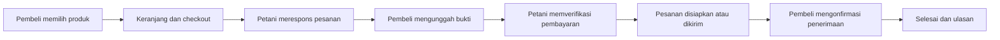
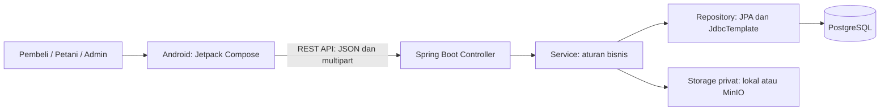

# 🌱 Panenku

**Platform Android untuk penjualan hasil panen langsung dari petani kepada pembeli.** Panenku membantu mengelola katalog, stok, pesanan, pembayaran, hingga refund dalam satu alur yang diawasi admin.

Proyek ini dikembangkan untuk praktikum Pengembangan Aplikasi Perangkat Bergerak. Aplikasi memakai REST API dan ditujukan untuk pengembangan, pengujian, dan demonstrasi; pengujian perangkat tetap diperlukan sebelum penggunaan produksi.

[Dokumentasi Android](android-app/README.md) · [Dokumentasi Backend](backend/README.md) · [Panduan Integrasi](docs/INTEGRASI.md)

## Masalah dan solusi

Petani membutuhkan kanal untuk menawarkan hasil panen dan mengelola stok. Pembeli membutuhkan informasi produk, transaksi yang jelas, serta cara melaporkan masalah. Panenku mempertemukan keduanya melalui aplikasi Android, sementara admin memverifikasi identitas petani dan menangani sengketa.

## Pengguna dan fitur

| Peran | Fitur utama |
| --- | --- |
| **Pembeli** | Katalog, keranjang, checkout, bukti pembayaran, pelacakan pesanan, refund, bantuan, notifikasi, dan ulasan. |
| **Petani** | Profil toko, KTP, produk dan stok, foto produk, rekening/QRIS, verifikasi pembayaran, pemenuhan pesanan, dan respons refund. |
| **Admin** | Verifikasi KTP, pengelolaan pengguna, limit dan komoditas, audit log, sengketa refund, dan laporan pembayaran terlambat. |

Pembayaran dilakukan langsung kepada petani di luar aplikasi. Pembeli mengunggah bukti dan petani memeriksanya secara manual; unggah bukti tidak otomatis berarti pembayaran terverifikasi.

## Alur utama



Jika ada masalah, pembeli dapat mengajukan refund; petani memberikan respons dan sengketa dapat dieskalasikan ke admin sesuai kondisi pesanan. Verifikasi KTP dilakukan admin sebelum produk petani diterbitkan.

## Arsitektur sistem



Android mengelola tampilan dan state melalui ViewModel, StateFlow, dan Coroutines. Backend menangani autentikasi JWT, otorisasi berdasarkan peran, aturan stok dan transaksi. Flyway mengelola perubahan skema database.

| Komponen | Teknologi |
| --- | --- |
| Android | Kotlin, Jetpack Compose, Material 3, ViewModel, StateFlow, Coroutines |
| Integrasi | Retrofit, OkHttp, Gson, Coil |
| Backend | Kotlin, Spring Boot, Spring Security, JWT, BCrypt |
| Data | PostgreSQL, Spring Data JPA, JdbcTemplate, Flyway |
| Development | Gradle, Docker Compose, MinIO atau storage lokal privat |

## Struktur proyek

```text
Panenku/
├── android-app/                      # Aplikasi Android
│   ├── app/src/main/java/com/example/android/
│   │   ├── data/                     # Model, repository, dan API
│   │   ├── features/                 # Fitur F1–F7
│   │   ├── navigation/               # Navigasi aplikasi
│   │   └── ui/
│   │       ├── auth/                 # Autentikasi dan pendaftaran
│   │       ├── connected/            # Layar terhubung API
│   │       │   ├── buyer/            # Alur pembeli
│   │       │   └── farmer/           # Alur petani
│   │       ├── admin/                # Alur admin
│   │       └── theme/                # Tema visual
│   ├── app/src/test/                 # Unit dan UI test
│   └── README.md
├── backend/                          # Spring Boot REST API
│   ├── src/main/kotlin/com/panenku/backend/
│   │   ├── common/                   # Keamanan, validasi, storage, error
│   │   ├── config/                   # Konfigurasi aplikasi
│   │   ├── modules/                  # Controller, service, repository, DTO
│   │   │   ├── pembeli/
│   │   │   ├── petani/
│   │   │   ├── admin/
│   │   │   └── shared/
│   │   └── scheduler/                # Pekerjaan terjadwal
│   ├── src/main/resources/db/migration/ # Migrasi Flyway
│   ├── src/test/                     # Unit dan integration test
│   ├── demo-assets/foto-dummy/       # Gambar contoh UAT
│   ├── scripts/                      # Script development
│   └── README.md
└── docs/                             # Panduan integrasi dan dokumentasi tim
```

## Menjalankan proyek

Siapkan Android Studio, Android SDK 35, JDK 17, dan Docker Desktop atau OrbStack. Android mendukung API 26 ke atas. Pastikan port `8080` tersedia.

### Backend: Windows dan emulator

Dari root repository, jalankan di PowerShell:

```powershell
powershell -ExecutionPolicy Bypass -File backend/scripts/start-integration.ps1
```

Script menyiapkan konfigurasi lokal dan menjalankan backend, PostgreSQL, serta MinIO melalui Docker Compose. Tunggu pesan `Started ApplicationKt` pada log:

```powershell
docker compose --env-file backend/.env.integration -f backend/docker-compose.integration.yml logs -f api
```

### Backend: macOS untuk UAT lokal

Siapkan `backend/.env` berdasarkan `backend/.env.example`, termasuk database dan JWT secret, lalu jalankan:

```bash
cd backend
bash scripts/start-local-mac.sh
```

Script mengaktifkan penyimpanan foto produk dan bukti secara lokal. Rincian konfigurasi dan alternatif MinIO tersedia di [README backend](backend/README.md).

### Aplikasi Android

1. Buka folder `android-app/` di Android Studio, pilih Gradle JDK 17, dan lakukan Gradle Sync.
2. Untuk emulator, URL default adalah `http://10.0.2.2:8080/api/v1/`.
3. Untuk HP fisik via USB, jalankan `adb reverse tcp:8080 tcp:8080`, lalu atur `PANENKU_API_URL=http://127.0.0.1:8080/api/v1/` di `android-app/local.properties`.
4. Jalankan konfigurasi `app`. Daftarkan akun pembeli atau petani; akun admin disiapkan melalui prosedur backend.

URL API harus diakhiri `/`. Perubahan URL memerlukan build ulang aplikasi. Lihat [README Android](android-app/README.md) untuk build APK dan konfigurasi lebih lengkap.

## Foto untuk pengujian

Folder [foto dummy](backend/demo-assets/foto-dummy/) menyediakan contoh produk, KTP dummy, QRIS, bukti pembayaran, dan refund. Pilih file melalui aplikasi saat pengujian; menyalin gambar ke folder saja tidak membuat produk atau transaksi.

Storage produk lokal dan storage bukti memakai folder privat terpisah. File unggahan tetap di mesin masing-masing dan tidak ikut tersinkron saat `git pull`. Jangan masukkan foto KTP asli, bukti transaksi, token, atau file `.env` ke repository.

## Pengujian

```bash
# Backend: test integrasi memerlukan Docker
cd backend
./gradlew test

# Android: dari root repository
cd ../android-app
bash ./gradlew testDebugUnitTest
bash ./gradlew assembleDebug
```

Selain test otomatis, lakukan UAT di perangkat untuk alur pembeli, petani, dan admin, termasuk pembayaran, refund, validasi unggahan, serta kondisi koneksi terputus. Gunakan akun dan berkas dummy untuk demonstrasi.
