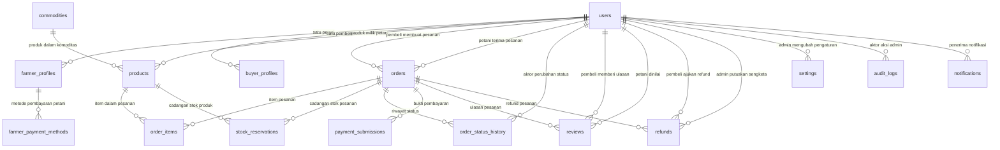

# Panenku Backend

Backend untuk aplikasi Android **Panenku** — e-commerce penjualan hasil tani langsung dari petani ke pembeli/UMKM (MVP v1.0).

Dikembangkan sebagai tugas akhir praktikum Pengembangan Aplikasi Perangkat Bergerak, Program Studi Teknik Informatika, Universitas Brawijaya 2026.

---

## 📋 Ringkasan Proyek

| Item | Detail |
|------|--------|
| Nama Aplikasi | Panenku |
| Target Platform | Android (REST API JSON) |
| Peran Pengguna | Pembeli, Petani, Admin |
| Pembayaran | QRIS / Transfer Bank ke rekening pribadi petani (manual verifikasi) |
| Komisi Platform | Tanpa komisi (Rp0) |
| Satuan Produk | Kilogram (kg), pecahan diperbolehkan (0.01 kg) |
| Limit Transaksi | Rp10.000.000 per checkout (termasuk ongkir) |
| Zona Waktu | WIB (Asia/Jakarta) |
| Database | PostgreSQL (ACID transactions) |
| File Storage | MinIO / AWS S3 (privat, tidak ada link publik permanen) |

---

## 🏗️ Arsitektur Backend

Kami menggunakan **Layered Architecture** dengan pemisahan kode berdasarkan **peran (role)**. Tidak menggunakan MVC murni karena backend hanya menyediakan REST API (tidak ada View/HTML rendering), dan logika bisnis terlalu kompleks untuk ditumpuk di Controller.

### Alur Permintaan

```
Android App → Controller → Service → Repository → Database
```

> Spring MVC menangani routing lewat anotasi (`@GetMapping`, `@PostMapping`, dll) di Controller, sehingga tidak ada lapisan `Routes` terpisah.

Setiap lapisan hanya boleh berkomunikasi dengan lapisan di bawahnya. Tidak boleh lompat layer.

### 4 Layer Utama

| Layer | Folder | Tanggung Jawab |
|-------|--------|----------------|
| **Controller** | `modules/{role}/controller/` | Terima request HTTP, validasi input sederhana, panggil Service, kirim JSON response |
| **Service** | `modules/{role}/service/` | **Logika bisnis inti** (aturan PRD & PDF): cek stok, hitung limit, state machine pesanan, verifikasi refund, dll |
| **Repository** | `modules/{role}/repository/` | Akses langsung ke database PostgreSQL, query SQL, transaksi ACID |
| **DTO** | `modules/{role}/dto/` | Wadah data request/response (jangan expose tabel database langsung ke Android) |

### Folder Pendukung

| Folder | Tanggung Jawab |
|--------|----------------|
| `common/` | Kode bersama semua role: JWT, exception handling, file storage, validasi decimal, idempotency |
| `config/` | Konfigurasi environment, database, JWT, server port |
| `scheduler/` | Background job (misal: kedaluwarsa pesanan 24 jam) |

> **Catatan implementasi:** proyek memakai Spring MVC, jadi **tidak ada folder `routes/`**. Mapping URL ditulis lewat anotasi di Controller, sedangkan autentikasi/otorisasi ditangani `config/SecurityConfig.kt` dan `common/security/ActorService.kt`.

---

## 📂 Struktur Folder

> **Catatan:** struktur di bawah adalah **rancangan target**. Implementasi saat ini memakai Spring MVC sehingga tidak memiliki folder `routes/` dan memakai `resources/application.properties` (bukan `application.conf`). Perbedaan lain dicatat di bagian **Status Implementasi & Deviasi** di bawah.

```text
backend/                              ← ROOT PROJECT (sudah ada)
├── build.gradle.kts                  ← Konfigurasi Gradle & dependencies
├── settings.gradle.kts
├── docker-compose.yml                ← PostgreSQL + MinIO (opsional)
├── Dockerfile
├── README.md                         ← File ini
└── src/
    └── main/
        └── kotlin/
            └── com/
                └── panenku/
                    └── backend/      ← Package root: com.panenku.backend
                        ├── Application.kt          ← Entry point, wiring semua module
                        ├── config/
                        │   └── AppConfig.kt        ← ENV, DB, JWT, MinIO, server port
                        │
                        ├── common/                 └─────── Shared semua role
                        │   ├── dto/
                        │   │   ├── ApiResponse.kt
                        │   │   └── ErrorResponse.kt
                        │   ├── exception/
                        │   │   ├── AppException.kt
                        │   │   └── ExceptionHandler.kt
                        │   ├── auth/
                        │   │   ├── JwtProvider.kt
                        │   │   └── JwtAuthProvider.kt
                        │   ├── security/
                        │   │   └── RoleGuard.kt
                        │   ├── storage/
                        │   │   └── FileStorage.kt
                        │   ├── validation/
                        │   │   └── DecimalValidator.kt
                        │   └── idempotency/
                        │       └── IdempotencyStore.kt
                        │
                        ├── modules/
                        │   ├── shared/             └─────── Digunakan semua role
                        │   │   ├── controller/   AuthController, UserController
                        │   │   ├── service/      AuthService, UserService
                        │   │   ├── repository/   UserRepository, AuthRepository
                        │   │   ├── dto/          RegisterRequest, LoginRequest, UserDTO
                        │   │   └── routes/       AuthRoutes, UserRoutes
                        │   │
                        │   ├── admin/            └─────── Role: Admin (pengelola)
                        │   │   ├── controller/   KtpVerification, UserManagement, Commodity, RefundDispute, Settings
                        │   │   ├── service/      KtpVerification, UserManagement, Commodity, RefundDispute, Settings, AuditLog
                        │   │   ├── repository/   KtpVerification, User, Commodity, Refund, Settings, AuditLog
                        │   │   ├── dto/          KtpVerifyRequest, SuspendUserRequest, LimitUpdateRequest, AuditLogDTO
                        │   │   └── routes/       AdminRoutes
                        │   │
                        │   ├── pembeli/          └─────── Role: Pembeli
                        │   │   ├── controller/   Catalog, Cart, Checkout, Order, PaymentProof, Review, Refund, Escalation, Notification
                        │   │   ├── service/      Catalog, Cart, Checkout, Order, PaymentSubmission, Review, Refund, Escalation, Notification
                        │   │   ├── repository/   Product, Cart, Order, OrderItem, StockReservation, PaymentSubmission, Review, Refund, Notification
                        │   │   ├── dto/          ProductCatalogDTO, CartItemRequest, CheckoutRequest, OrderDTO, PaymentProofRequest, RefundRequest, ReviewRequest
                        │   │   └── routes/       BuyerRoutes
                        │   │
                        │   └── petani/           └─────── Role: Petani
                        │       ├── controller/   Profile, Product, PaymentMethod, KtpApplication, Order, PaymentVerification, Fulfillment, RefundResponse
                        │       ├── service/      FarmerProfile, Product, PaymentMethod, KtpApplication, Order, PaymentVerification, Fulfillment, RefundResponse
                        │       ├── repository/   FarmerProfile, Product, PaymentMethod, KtpApplication, Order, PaymentSubmission, Refund
                        │       ├── dto/          FarmerProfileDTO, ProductRequest, PaymentMethodRequest, KtpApplicationRequest, OrderResponse, PaymentVerificationRequest, FulfillmentUpdateRequest, RefundResponseRequest
                        │       └── routes/       FarmerRoutes
                        │
                        └── scheduler/            └─────── Background job
                            └── ExpirationJob.kt    ← Kedaluwarsa 24 jam (server time)
        └── resources/
            └── application.conf

    └── test/
        └── kotlin/com/panenku/backend/
            ├── shared/
            ├── admin/
            ├── pembeli/
            ├── petani/
            └── integration/
```

> **Catatan:** `com/panenku/backend/` adalah package Kotlin (namespace), bukan project baru di dalam project. Semua kode tinggal di dalam folder `backend/` yang sudah ada.

---

## 👥 Pemisahan Per Role

| Role | Folder | Contoh Fungsi Utama |
|------|--------|---------------------|
| **Admin** | `modules/admin/` | Verifikasi KTP petani, suspend/pulihkan user, kelola komoditas, ubah limit transaksi, tiket eskalasi refund, audit log |
| **Pembeli** | `modules/pembeli/` | Katalog produk, keranjang, checkout, pesanan, upload bukti pembayaran, ulasan, refund, eskalasi |
| **Petani** | `modules/petani/` | Profil toko, produk & stok, metode pembayaran (QRIS/Bank), ajukan KTP, terima/tolak pesanan, verifikasi bukti, status pemenuhan, respons refund |
| **Shared** | `modules/shared/` | Register, login, logout, profil pengguna (digunakan semua role) |

---

## 📋 Aturan Bisnis (dari PRD & Laporan Praktikum)

Backend harus mengimplementasi aturan berikut:

1. **Stok atomik**: Pembuatan Order + cadangan stok dalam **satu transaksi database** (tidak ada oversell, tidak ada pesanan parsial).
2. **Stok tersedia** = stok fisik − stok yang sedang dicadangkan.
3. **Limit transaksi** Rp10.000.000 per checkout (termasuk ongkir). Total tepat limit = diterima, di atas limit = ditolak.
4. **Snapshot immutable**: Harga, ongkir, alamat, jadwal, rekening disalin saat checkout. Perubahan data setelahnya tidak mengubah transaksi lama.
5. **Bukti pembayaran ≠ lunas**: Petani harus memverifikasi bukti secara manual (terima/tolak dengan alasan).
6. **Setiap perubahan status pesanan** dicatat ke `order_status_history` dengan aktor dan waktu.
7. **Batas waktu 24 jam**: Respons petani & upload bukti pembayaran. Jika terlewati → pesanan kedaluwarsa, stok dicadangkan dilepas.
8. **Refund maksimal 1 pengajuan aktif per pesanan**. Nominal refund ≤ nominal pembayaran. Jendela maksimal 24 jam setelah `received_at` (kecuali pesanan gagal dipenuhi).
9. **File privat**: KTP, bukti pembayaran, bukti refund hanya bisa diakses pihak transaksi dan admin berwenang. Tidak ada link publik permanen.
10. **Decimal tepat**: Rupiah dan kg pakai `BIGINT` / `DECIMAL`, **bukan floating point biner**.
11. **Idempotensi**: Retry request jaringan tidak menghasilkan Order, Refund, atau Ulasan ganda.
12. **Role-Based Access Control**: Pembeli tidak bisa mengakses fungsi petani/admin. Admin tidak bisa didaftar melalui formulir publik.

---

## 🗄️ Skema Database Lengkap

> **Catatan:** skema di bawah adalah **desain target MVP**. Skema yang benar-benar dijalankan saat ini ada di `src/main/resources/db/migration/V1–V21`. Perbedaan antara desain dan implementasi dicatat di bagian **Status Implementasi & Deviasi**.

### Konsep Umum

| Keputusan | Alasan |
|-----------|--------|
| Database | **PostgreSQL** (ACID, support `DECIMAL`, UUID, JSONB) |
| Primary Key | `UUID` untuk semua tabel |
| Waktu | `TIMESTAMPTZ`, zona referensi **WIB** (Asia/Jakarta) |
| Uang & Berat | `BIGINT` untuk rupiah (menghindari float), `DECIMAL(10,2)` untuk kg |
| File | Simpan **path/file ID** saja di DB, file fisik ada di MinIO/S3 (privat) |
| Transaksi | Order + StockReservation dalam **satu transaksi DB** (atomic) |

---

### ERD (Entity Relationship Diagram)



**Penjelasan singkat ERD:**
- `users` adalah tabel pusat untuk semua role (`pembeli`, `petani`, `admin`).
- Setiap role memiliki profil terpisah: `farmer_profiles` atau `buyer_profiles`.
- `orders` terhubung ke satu pembeli dan satu petani (satu petani per checkout).
- `order_items` dan `stock_reservations` menghubungkan pesanan dengan produk.
- `order_status_history` mencatat setiap perubahan status dengan siapa dan kapan.
- `payment_submissions`, `reviews`, dan `refunds` semua terhubung ke satu `orders`.

---

### Tabel & Kolom

#### 1. `users` — Akun semua role

| Kolom | Tipe | Keterangan |
|-------|------|------------|
| `id` | UUID PK | |
| `email` | VARCHAR(255) UNIQUE NOT NULL | Login |
| `password_hash` | VARCHAR(255) NOT NULL | bcrypt / argon2 |
| `role` | VARCHAR(20) NOT NULL | `pembeli` / `petani` / `admin` |
| `status` | VARCHAR(20) NOT NULL DEFAULT 'active' | `active` / `suspended` |
| `created_at` | TIMESTAMPTZ DEFAULT now() | |
| `updated_at` | TIMESTAMPTZ DEFAULT now() | |

**Constraint:** `role` CHECK IN ('pembeli','petani','admin'), `status` CHECK IN ('active','suspended')

---

#### 2. `farmer_profiles` — Profil petani

| Kolom | Tipe | Keterangan |
|-------|------|------------|
| `id` | UUID PK → users.id | |
| `store_name` | VARCHAR(255) NOT NULL | Nama toko |
| `contact_phone` | VARCHAR(20) | Kontak petani (digunakan admin untuk kontak verifikasi KTP) |
| `pickup_location` | TEXT | Lokasi pengambilan (ambil sendiri) |
| `service_area` | TEXT | Daftar kecamatan layanan antar (bukan radius GPS) |
| `delivery_fee` | BIGINT NOT NULL DEFAULT 0 | Ongkir tetap per pesanan (rupiah) |
| `shipping_enabled` | BOOLEAN NOT NULL DEFAULT false | Aktifkan layanan antar? |
| `ktp_status` | VARCHAR(20) NOT NULL DEFAULT 'belum_diajukan' | `belum_diajukan` / `menunggu` / `disetujui` / `ditolak` |
| `ktp_rejection_reason` | TEXT | Alasan penolakan (wajib jika ditolak) |
| `ktp_document_path` | VARCHAR(512) | Path file KTP dummy di MinIO (privat) |
| `ktp_submitted_at` | TIMESTAMPTZ NULL | |
| `ktp_reviewed_at` | TIMESTAMPTZ NULL | |
| `ktp_reviewed_by` | UUID → users.id | Admin yang memutuskan |
| `created_at` / `updated_at` | TIMESTAMPTZ | |

**Aturan:** `ktp_status` dan `users.status` (suspend) adalah **dua atribut terpisah**. Petani yang KTP-nya disetujui tapi sedang `suspended` tetap tidak bisa terima pesanan baru.

---

#### 3. `buyer_profiles` — Profil pembeli

| Kolom | Tipe | Keterangan |
|-------|------|------------|
| `id` | UUID PK → users.id | |
| `full_name` | VARCHAR(255) NOT NULL | |
| `contact_phone` | VARCHAR(20) | |
| `delivery_address` | TEXT | Alamat untuk pengantaran |
| `created_at` / `updated_at` | TIMESTAMPTZ | |

---

#### 4. `commodities` — Komoditas sayuran

| Kolom | Tipe | Keterangan |
|-------|------|------------|
| `id` | UUID PK | |
| `name` | VARCHAR(100) NOT NULL UNIQUE | Nama komoditas (cabai, tomat, sawi, dll) |
| `is_active` | BOOLEAN NOT NULL DEFAULT true | Nonaktifkan komoditas bermasalah |
| `created_at` / `updated_at` | TIMESTAMPTZ | |

**Aturan:** Komoditas yang sudah ada transaksi jangan dihapus (hanya nonaktifkan). Snapshot pesanan tetap tampilkan nama komoditas asal.

---

#### 5. `products` — Produk petani

| Kolom | Tipe | Keterangan |
|-------|------|------------|
| `id` | UUID PK | |
| `farmer_id` | UUID NOT NULL → users.id | Pemilik produk |
| `commodity_id` | UUID NOT NULL → commodities.id | |
| `name` | VARCHAR(255) NOT NULL | Nama produk |
| `description` | TEXT | Opsional: kondisi, asal, catatan penyimpanan |
| `photo_url` | VARCHAR(512) | Path foto produk di MinIO (privat) |
| `price_per_kg` | BIGINT NOT NULL CHECK (> 0) | Harga per kg (rupiah) |
| `stock_physical` | DECIMAL(10,2) NOT NULL DEFAULT 0 | Stok fisik (kg) |
| `stock_reserved` | DECIMAL(10,2) NOT NULL DEFAULT 0 | Stok sedang dicadangkan |
| `ready_date` | DATE NOT NULL | Tanggal paling awal tersedia |
| `publication_status` | VARCHAR(20) NOT NULL DEFAULT 'draft' | `draft` / `aktif` / `nonaktif` |
| `created_at` / `updated_at` | TIMESTAMPTZ | |

**Aturan bisnis:**
- Produk aktif memerlukan `farmer_profiles` lokasi lengkap + minimal 1 metode pembayaran lengkap.
- Petani tidak boleh mengurangi `stock_physical` di bawah total `stock_reserved` aktif.
- Stok tersedia = `stock_physical − stock_reserved`.
- Produk `nonaktif` atau `draft` tidak bisa masuk checkout baru.

---

#### 6. `farmer_payment_methods` — Metode pembayaran petani

| Kolom | Tipe | Keterangan |
|-------|------|------------|
| `id` | UUID PK | |
| `farmer_id` | UUID NOT NULL → users.id | |
| `method_type` | VARCHAR(20) NOT NULL | `qris` / `bank_transfer` |
| `qris_image_path` | VARCHAR(512) | Path gambar QRIS (untuk method_type=qris) |
| `bank_name` | VARCHAR(100) | Nama bank (untuk bank_transfer) |
| `account_number` | VARCHAR(50) NOT NULL | Teks, agar nol di depan tidak hilang |
| `account_holder_name` | VARCHAR(255) NOT NULL | Nama pemilik rekening |
| `created_at` / `updated_at` | TIMESTAMPTZ | |

**Aturan:** Minimal satu metode lengkap sebelum produk dapat diaktifkan. Nomor rekening disimpan sebagai teks.

---

#### 7. `orders` — Pesanan utama

| Kolom | Tipe | Keterangan |
|-------|------|------------|
| `id` | UUID PK | |
| `buyer_id` | UUID NOT NULL → users.id | |
| `farmer_id` | UUID NOT NULL → users.id | Satu petani per checkout |
| `fulfillment_method` | VARCHAR(20) NOT NULL | `pickup` / `delivery` |
| `delivery_fee` | BIGINT NOT NULL DEFAULT 0 | **Snapshot** ongkir saat checkout |
| `subtotal_items` | BIGINT NOT NULL | **Snapshot** subtotal produk |
| `total_payment` | BIGINT NOT NULL | **Snapshot** subtotal + ongkir |
| `transaction_limit_applied` | BIGINT NOT NULL | Limit yang berlaku saat checkout (Rp10 juta default) |
| `order_status` | VARCHAR(30) NOT NULL DEFAULT 'menunggu_petani' | Lihat state machine di bawah |
| `payment_status` | VARCHAR(20) NOT NULL DEFAULT 'belum_dibayar' | `belum_dibayar` / `menunggu_verifikasi` / `bukti_ditolak` / `terverifikasi` |
| `scheduled_date` | DATE NOT NULL | Tanggal pengambilan/pengantaran |
| `scheduled_time_slot` | VARCHAR(100) | Rentang waktu yang dipilih pembeli |
| `pickup_location_snapshot` | TEXT | Lokasi pengambilan saat checkout |
| `delivery_address_snapshot` | TEXT | Alamat pengantaran saat checkout |
| `buyer_notes` | TEXT | Catatan pembeli |
| `received_at` | TIMESTAMPTZ NULL | Waktu pembeli konfirmasi penerimaan |
| `reserved_at` | TIMESTAMPTZ DEFAULT now() | Waktu cadangan stok dibuat |
| `expires_at` | TIMESTAMPTZ NOT NULL | Batas respons 24 jam |
| `created_at` / `updated_at` | TIMESTAMPTZ | |

**Aturan:**
- Semua kolom `*_snapshot` diisi saat checkout dan **tidak boleh berubah** meski produk/profil nanti diubah.
- `total_payment` = subtotal + ongkir, harus ≤ `transaction_limit_applied`.
- Satu petani per checkout (scope CART01).

---

#### 8. `order_items` — Item pesanan

| Kolom | Tipe | Keterangan |
|-------|------|------------|
| `id` | UUID PK | |
| `order_id` | UUID NOT NULL → orders.id | |
| `product_id` | UUID NOT NULL → products.id | |
| `product_name_snapshot` | VARCHAR(255) | Nama produk saat checkout |
| `commodity_snapshot` | VARCHAR(100) | Komoditas saat checkout |
| `quantity_kg` | DECIMAL(10,2) NOT NULL CHECK (> 0) | Jumlah kg (pecahan diperbolehkan, min 0.01) |
| `price_per_kg_snapshot` | BIGINT NOT NULL | Harga per kg saat checkout |
| `item_subtotal` | BIGINT NOT NULL | quantity_kg × price_per_kg, dibulatkan half-up ke rupiah |
| `created_at` | TIMESTAMPTZ | |

---

#### 9. `stock_reservations` — Cadangan stok

| Kolom | Tipe | Keterangan |
|-------|------|------------|
| `id` | UUID PK | |
| `product_id` | UUID NOT NULL → products.id | |
| `order_id` | UUID NOT NULL → orders.id | |
| `quantity_kg` | DECIMAL(10,2) NOT NULL | |
| `status` | VARCHAR(20) NOT NULL DEFAULT 'active' | `active` / `released` / `fulfilled` |
| `reserved_at` | TIMESTAMPTZ DEFAULT now() | |
| `released_at` | TIMESTAMPTZ NULL | Dilepas jika batal/ditolak/kedaluwarsa |
| `fulfilled_at` | TIMESTAMPTZ NULL | Terpenuhi saat barang diserahkan/diantar |

**Aturan:** Setiap cadangan dilepas **tepat satu kali**. Jika pesanan ditolak/dibatalkan/kedaluwarsa/gagal dipenuhi → cadangan dilepas sekali.

---

#### 10. `order_status_history` — Riwayat status pesanan

| Kolom | Tipe | Keterangan |
|-------|------|------------|
| `id` | UUID PK | |
| `order_id` | UUID NOT NULL → orders.id | |
| `from_status` | VARCHAR(30) NULL | |
| `to_status` | VARCHAR(30) NOT NULL | |
| `actor_id` | UUID NOT NULL → users.id | Siapa yang mengubah |
| `actor_role` | VARCHAR(20) NOT NULL | `pembeli` / `petani` / `admin` |
| `changed_at` | TIMESTAMPTZ DEFAULT now() | |
| `note` | TEXT | Catatan/alasan perubahan |

---

#### 11. `payment_submissions` — Bukti pembayaran

| Kolom | Tipe | Keterangan |
|-------|------|------------|
| `id` | UUID PK | |
| `order_id` | UUID NOT NULL → orders.id | |
| `payment_method` | VARCHAR(20) NOT NULL | `qris` / `bank_transfer` |
| `recipient_snapshot` | JSONB NOT NULL | Snapshot penerima: nama bank, norek, nama pemilik, info QRIS |
| `total_amount` | BIGINT NOT NULL | Nominal yang ditransfer |
| `proof_image_path` | VARCHAR(512) | Path foto bukti di MinIO (privat) |
| `status` | VARCHAR(20) NOT NULL DEFAULT 'menunggu_verifikasi' | `menunggu_verifikasi` / `bukti_ditolak` / `terverifikasi` |
| `farmer_decision` | VARCHAR(20) NULL | `terima` / `tolak` |
| `farmer_decision_reason` | TEXT | Alasan jika ditolak |
| `farmer_decided_at` | TIMESTAMPTZ NULL | |
| `submitted_at` | TIMESTAMPTZ DEFAULT now() | |
| `updated_at` | TIMESTAMPTZ | |

**Aturan:**
- Hanya petani pemilik pesanan yang dapat memverifikasi.
- Riwayat bukti dan keputusan disimpan (tidak double verification/stok).
- Bukti ditolak → kembali ke `menunggu_pembayaran` dengan batas 24 jam baru, bukti lama tetap tercatat.

---

#### 12. `reviews` — Ulasan pembeli

| Kolom | Tipe | Keterangan |
|-------|------|------------|
| `id` | UUID PK | |
| `order_id` | UUID NOT NULL UNIQUE → orders.id | Satu ulasan per pesanan |
| `buyer_id` | UUID NOT NULL → users.id | |
| `farmer_id` | UUID NOT NULL → users.id | |
| `rating` | INTEGER NOT NULL CHECK BETWEEN 1 AND 5 | Bintang wajib |
| `comment` | VARCHAR(500) | Opsional, maks 500 karakter |
| `created_at` | TIMESTAMPTZ | |

**Aturan:** Hanya bisa ulasan setelah pesanan `selesai`. Rating petani = rata-rata ulasan valid.

---

#### 13. `refunds` — Pengajuan refund

| Kolom | Tipe | Keterangan |
|-------|------|------------|
| `id` | UUID PK | |
| `order_id` | UUID NOT NULL → orders.id | |
| `buyer_id` | UUID NOT NULL → users.id | |
| `reason` | TEXT NOT NULL | Alasan refund |
| `evidence_photo_path` | VARCHAR(512) | Foto bukti (opsional) |
| `refund_amount` | BIGINT NOT NULL | Nominal refund penuh (produk + ongkir), ≤ pembayaran |
| `destination_type` | VARCHAR(20) NOT NULL | `bank` / `e-wallet` |
| `destination_provider` | VARCHAR(100) | Nama penyedia |
| `destination_account` | VARCHAR(100) | Nomor tujuan |
| `destination_name` | VARCHAR(255) | Nama penerima |
| `status` | VARCHAR(20) NOT NULL DEFAULT 'diajukan' | Lihat state machine di bawah |
| `farmer_response_reason` | TEXT | Alasan jika petani tolak |
| `farmer_proof_transfer_path` | VARCHAR(512) | Bukti transfer balik petani |
| `farmer_approved_at` | TIMESTAMPTZ NULL | |
| `buyer_confirmed_at` | TIMESTAMPTZ NULL | Pembeli konfirmasi dana masuk |
| `escalated_at` | TIMESTAMPTZ NULL | Waktu eskalasi ke admin |
| `escalation_reason` | TEXT | |
| `admin_decision` | TEXT | Keputusan admin (suspend / tutup tiket) |
| `admin_decided_by` | UUID → users.id | |
| `admin_decided_at` | TIMESTAMPTZ NULL | |
| `created_at` / `updated_at` | TIMESTAMPTZ | |

**Aturan:**
- Maksimal satu pengajuan aktif per pesanan.
- Jendela maksimal 24 jam setelah `received_at` (kecuali pesanan gagal dipenuhi tanpa received_at).
- Status setelah unggah bukti transfer balik = `menunggu_konfirmasi_dana`, bukan `selesai`.
- Hanya selesai setelah pembeli tekan "Dana sudah diterima".

---

#### 14. `settings` — Pengaturan admin

| Kolom | Tipe | Keterangan |
|-------|------|------------|
| `id` | UUID PK | |
| `setting_key` | VARCHAR(100) UNIQUE NOT NULL | `transaction_limit`, `cs_whatsapp`, `expiry_hours` |
| `setting_value` | TEXT NOT NULL | Misal: `10000000` |
| `changed_by` | UUID → users.id | Admin yang mengubah |
| `changed_at` | TIMESTAMPTZ DEFAULT now() | |
| `reason` | TEXT | Alasan perubahan |

**Aturan:** Nilai, alasan, admin, waktu perubahan dicatat. Batas baru hanya berlaku pada pesanan baru (snapshot pada pesanan lama tidak berubah).

---

#### 15. `audit_logs` — Rekam jejak admin

| Kolom | Tipe | Keterangan |
|-------|------|------------|
| `id` | UUID PK | |
| `actor_id` | UUID NOT NULL → users.id | |
| `actor_role` | VARCHAR(20) NOT NULL | |
| `action` | VARCHAR(100) NOT NULL | `verify_ktp`, `suspend_user`, `change_limit`, `close_dispute`, dll |
| `target_type` | VARCHAR(50) | `user`, `order`, `refund`, `product`, `commodity` |
| `target_id` | UUID | ID target aksi |
| `old_values` | JSONB | Data sebelum berubah |
| `new_values` | JSONB | Data setelah berubah |
| `reason` | TEXT | Alasan aksi admin |
| `created_at` | TIMESTAMPTZ DEFAULT now() | |

---

#### 16. `notifications` — Notifikasi in-app

| Kolom | Tipe | Keterangan |
|-------|------|------------|
| `id` | UUID PK | |
| `user_id` | UUID NOT NULL → users.id | Penerima notifikasi |
| `title` | VARCHAR(255) NOT NULL | |
| `body` | TEXT | |
| `type` | VARCHAR(50) | `order`, `payment`, `refund`, `system` |
| `is_read` | BOOLEAN NOT NULL DEFAULT false | |
| `deep_link` | VARCHAR(512) | Layar tujuan di Android |
| `created_at` | TIMESTAMPTZ DEFAULT now() | |

---

### State Machines (Status)

#### Order Status (`orders.order_status`)

```
menunggu_petani
    ├─ petani terima ──→ menunggu_pembayaran
    ├─ petani tolak ──→ ditolak (stok dilepas)
    ├─ pembeli batal ──→ dibatalkan (stok dilepas)
    └─ kedaluwarsa 24 jam ──→ kedaluwarsa (stok dilepas)

menunggu_pembayaran
    ├─ pembeli upload bukti ──→ verifikasi_pembayaran
    └─ kedaluwarsa 24 jam ──→ kedaluwarsa

verifikasi_pembayaran
    ├─ petani terima bukti ──→ diproses
    ├─ petani tolak bukti ──→ menunggu_pembayaran (batas baru 24 jam)
    └─ (belum auto-expire saat verifikasi berlangsung)

diproses
    ├─ pickup: petani siap diambil ──→ siap_diambil
    ├─ delivery: petani mulai antar ──→ diantar
    └─ petani gagal dipenuhi ──→ gagal_dipenuhi (refund tersedia)

siap_diambil / diantar
    ├─ petani tandai diterima/tiba ──→ menunggu_penerimaan

menunggu_penerimaan
    ├─ pembeli konfirmasi ──→ selesai (received_at dicatat)
    └─ laporkan kendala ──→ refund / eskalasi
```

**Aturan transisi:** Hanya transisi yang sah sesuai `fulfillment_method`. Setiap perubahan dicatat ke `order_status_history`.

#### Payment Status (`payment_submissions.status`)

```
belum_dibayar → menunggu_verifikasi → bukti_ditolak → (ulangi upload) → menunggu_verifikasi
                                           ↳ terverifikasi → order berubah ke diproses
```

#### Refund Status (`refunds.status`)

```
diajukan → disetujui → menunggu_konfirmasi_dana → selesai
   ↳ ditolak ←──┬──────→ dieskalasi ←── admin review
   ↳ dieskalasi ←──────────────────────────────┘
   ↳ ditutup_admin ←── admin putuskan
```

#### KTP Status (`farmer_profiles.ktp_status`)

```
belum_diajukan → menunggu → disetujui
                  ↳ ditolak → (perbaiki & ajukan ulang) → menunggu
```

**Catatan:** `ktp_status` terpisah dari `users.status` (active/suspended).

---

## 🏛️ Class Diagram

Diagram kelas di bawah ini menunjukkan struktur class Kotlin, relasi antar kelas, dan pola arsitektur yang digunakan (Layered Architecture: Controller → Service → Repository → Database).

```mermaid
classDiagram
    %% ================================================================
    %% LAYERED ARCHITECTURE PATTERN (Controller -> Service -> Repository)
    %% ================================================================
    
    class AuthController {
        <<REST Controller>>
        +register(RegisterRequest)
        +login(LoginRequest)
        +logout()
    }
    
    class AuthService {
        <<Service>>
        +authenticate(email, password)
        +generateJWT(User)
        +validateToken(token)
    }
    
    class UserRepository {
        <<JpaRepository>>
        +findByEmail(email)
        +existsByEmail(email)
        +save(User)
    }
    
    class User {
        <<Entity>>
        -id: UUID
        -email: String
        -passwordHash: String
        -role: Role
        -status: AccountStatus
        -createdAt: LocalDateTime
    }
    
    AuthController ..> AuthService : uses
    AuthService ..> UserRepository : uses
    AuthService ..> User : manages
    UserRepository <|..| User : Spring Data JPA for
    
    %% ================================================================
    %% CORE DOMAIN: USER & PROFILES (1:1)
    %% ================================================================
    
    class FarmerProfile {
        <<Entity>>
        -id: UUID
        -storeName: String
        -contactPhone: String
        -pickupLocation: String
        -serviceArea: String
        -deliveryFee: Long
        -shippingEnabled: Boolean
        -ktpStatus: KTPStatus
        -ktpDocumentPath: String
    }
    
    class BuyerProfile {
        <<Entity>>
        -id: UUID
        -fullName: String
        -contactPhone: String
        -deliveryAddress: String
    }
    
    User "1" *-- "0..1" FarmerProfile : has profile
    User "1" *-- "0..1" BuyerProfile : has profile
    FarmerProfile ..> User : linked to
    BuyerProfile ..> User : linked to
    
    %% ================================================================
    %% CORE DOMAIN: PRODUCT & COMMODITY
    %% ================================================================
    
    class Commodity {
        <<Entity>>
        -id: UUID
        -name: String
        -isActive: Boolean
    }
    
    class Product {
        <<Entity>>
        -id: UUID
        -name: String
        -pricePerKg: Long
        -stockPhysical: BigDecimal
        -stockReserved: BigDecimal
        -readyDate: LocalDate
        -publicationStatus: ProductStatus
    }
    
    class FarmerPaymentMethod {
        <<Entity>>
        -id: UUID
        -methodType: PaymentMethodType
        -accountNumber: String
        -accountHolderName: String
    }
    
    Commodity "1" *-- "0..*" Product : categorizes
    Product "1" *-- "0..*" FarmerPaymentMethod : offers
    FarmerProfile "1" *-- "0..*" Product : owns
    FarmerProfile "1" *-- "0..*" FarmerPaymentMethod : has
    
    %% ================================================================
    %% CORE DOMAIN: ORDER & ITEM
    %% ================================================================
    
    class Order {
        <<Entity>>
        -id: UUID
        -totalPayment: Long
        -orderStatus: OrderStatus
        -paymentStatus: PaymentStatus
        -scheduledDate: LocalDate
        -expiresAt: LocalDateTime
    }
    
    class OrderItem {
        <<Entity>>
        -id: UUID
        -quantityKg: BigDecimal
        -pricePerKgSnapshot: Long
        -itemSubtotal: Long
    }
    
    class StockReservation {
        <<Entity>>
        -id: UUID
        -quantityKg: BigDecimal
        -status: ReservationStatus
    }
    
    class OrderStatusHistory {
        <<Entity>>
        -id: UUID
        -fromStatus: OrderStatus
        -toStatus: OrderStatus
        -changedAt: LocalDateTime
    }
    
    BuyerProfile "1" *-- "0..*" Order : places
    FarmerProfile "1" *-- "0..*" Order : receives
    Order "1" *-- "0..*" OrderItem : contains
    Order "1" *-- "0..*" StockReservation : reserves
    Order "1" *-- "0..*" OrderStatusHistory : tracks
    
    %% ================================================================
    %% CORE DOMAIN: PAYMENT & REFUND
    %% ================================================================
    
    class PaymentSubmission {
        <<Entity>>
        -id: UUID
        -paymentMethod: PaymentMethodType
        -proofImagePath: String
        -status: PaymentSubmissionStatus
    }
    
    class Review {
        <<Entity>>
        -id: UUID
        -rating: Integer
        -comment: String
    }
    
    class Refund {
        <<Entity>>
        -id: UUID
        -refundAmount: Long
        -status: RefundStatus
    }
    
    Order "1" *-- "0..1" PaymentSubmission : has
    Order "1" *-- "0..1" Review : receives
    Order "1" *-- "0..*" Refund : generates
    BuyerProfile "1" *-- "0..*" Refund : requests
    
    %% ================================================================
    %% ADMIN DOMAIN
    %% ================================================================
    
    class Settings {
        <<Entity>>
        -id: UUID
        -settingKey: String
        -settingValue: String
    }
    
    class AuditLog {
        <<Entity>>
        -id: UUID
        -action: String
        -actorRole: Role
        -createdAt: LocalDateTime
    }
    
    class Notification {
        <<Entity>>
        -id: UUID
        -title: String
        -body: String
        -isRead: Boolean
    }
    
    User "1" *-- "0..*" AuditLog : performs
    User "1" *-- "0..*" Notification : receives
    Settings "1" *-- "0..1" User : changed by
    
    %% ================================================================
    %% SERVICE LAYER (representative)
    %% ================================================================
    
    class CheckoutService {
        <<Service>>
        +createOrder(CheckoutRequest)
        +validateStock()
        +validateLimit()
    }
    
    class OrderRepository {
        <<JpaRepository>>
        +findByBuyerId(UUID)
        +findByFarmerId(UUID)
    }
    
    class KtpVerificationService {
        <<Service>>
        +verifyKTP(farmerId, approved)
    }
    
    class RefundService {
        <<Service>>
        +requestRefund(orderId, reason)
        +escalateToAdmin(refundId)
    }
    
    CheckoutService ..> OrderRepository : uses
    CheckoutService ..> Order : manages
    CheckoutService ..> StockReservation : manages
    KtpVerificationService ..> FarmerProfile : manages
    RefundService ..> Refund : manages
    
    %% ================================================================
    %% CONTROLLER LAYER (representative)
    %% ================================================================
    
    class CheckoutController {
        <<REST Controller>>
        +POST /checkout
    }
    
    class OrderController {
        <<REST Controller>>
        +GET /orders
        +PUT /orders/{id}/status
    }
    
    CheckoutController ..> CheckoutService : calls
    OrderController ..> OrderService : calls
    
    %% ================================================================
    %% COMMON / CROSS-CUTTING
    %% ================================================================
    
    class JwtProvider {
        <<Utility>>
        +generateToken(User)
        +validateToken(String)
    }
    
    class RoleGuard {
        <<Filter>>
        +hasRole(role)
    }
    
    class ExceptionHandler {
        <<Controller Advice>>
        +handleException(Exception)
    }
    
    class ApiResponse {
        <<DTO>>
        -success: Boolean
        -data: Object
        -message: String
    }
    
    AuthController ..> JwtProvider : uses
    AuthController ..> RoleGuard : uses
    CheckoutController ..> ExceptionHandler : handled by
    CheckoutController ..> ApiResponse : returns
    
    %% ================================================================
    %% DTO LAYER
    %% ================================================================
    
    class CheckoutRequest {
        <<DTO>>
        -items: List<CartItemRequest>
        -fulfillmentMethod: String
        -scheduledDate: LocalDate
    }
    
    class OrderDTO {
        <<DTO>>
        -id: UUID
        -totalPayment: Long
        -status: OrderStatus
    }
    
    CheckoutController ..> CheckoutRequest : receives
    OrderController ..> OrderDTO : returns
```

### Notasi yang Digunakan

| Notasi | Arti | Contoh di Diagram |
|--------|------|-------------------|
| `<<Entity>>` | Kelas yang dipetakan ke tabel database (JPA/Hibernate) | `User`, `Order`, `Product` |
| `<<Service>>` | Kelas berisi logika bisnis (aturan PRD & PDF) | `AuthService`, `CheckoutService` |
| `<<REST Controller>>` | Kelas yang menangani endpoint HTTP / JSON | `AuthController`, `CheckoutController` |
| `<<JpaRepository>>` | Interface Spring Data JPA untuk akses DB | `UserRepository`, `OrderRepository` |
| `<<DTO>>` | Data Transfer Object untuk request/response | `CheckoutRequest`, `OrderDTO` |
| `<<Utility>>` / `<<Filter>>` / `<<Controller Advice>>` | Komponen penunjang umum | `JwtProvider`, `RoleGuard`, `ExceptionHandler` |
| `--|>` | Inheritance / Implementasi | `UserRepository <|..| User` |
| `*--` | Komposisi (milik, tidak bisa berdiri sendiri) | `Order *-- OrderItem` |
| `o--` | Asosiasi (terhubung tapi independen) | `User o-- FarmerProfile` |
| `..>` | Dependency / penggunaan | `Controller ..> Service` |
| `"1" *-- "0..*"` | Multiplicity (satu punya banyak, nol hingga banyak) | Buyer memiliki banyak Order |

### Relasi Penting dalam Sistem

| Relasi | Keterangan |
|--------|------------|
| `User` → `FarmerProfile` (1:1) | Setiap petani punya satu profil toko |
| `User` → `BuyerProfile` (1:1) | Setiap pembeli punya satu profil pembeli |
| `User` → `Product` (1:N) | Satu petani bisa punya banyak produk |
| `Commodity` → `Product` (1:N) | Satu komoditas bisa ada banyak produk |
| `Order` → `OrderItem` (1:N) | Satu pesanan bisa terdiri dari banyak item |
| `Order` → `StockReservation` (1:N) | Setiap pesanan mencadangkan stok satu atau lebih produk |
| `Order` → `PaymentSubmission` (1:1) | Satu pesanan memiliki satu bukti pembayaran |
| `Order` → `Refund` (1:N) | Satu pesanan bisa memiliki beberapa pengajuan refund |
| `User` → `AuditLog` (1:N) | Setiap aksi admin dicatat dalam audit log |

### Pola Antar Layer

```
Android App
    │ HTTP Request
    ▼
[Controller] ─────────► [Service] ─────────► [Repository] ─────────► [Database]
   (Endpoint)            (Logika Bisnis)     (Query SQL / JPA)     (PostgreSQL)
```

Setiap **Controller** hanya boleh memanggil **Service**. Setiap **Service** hanya boleh memanggil **Repository** dan mengelola **Entity**. Tidak ada Controller yang langsung akses Database.

---

### Aturan Database (Constraints & Business Rules)

| No | Aturan | Implementasi |
|----|--------|--------------|
| 1 | Stok atomik: Order + Reservation dalam satu transaksi | Transaksi aplikasi (BEGIN/COMMIT) |
| 2 | Tidak oversell: `stock_physical − stock_reserved ≥ 0` | `SELECT ... FOR UPDATE` (pessimistic locking) di service |
| 3 | Limit Rp10 juta: `total_payment ≤ transaction_limit_applied` | Validasi service |
| 4 | Snapshot immutable: kolom `*_snapshot` tidak diubah setelah dibuat | Validasi service |
| 5 | Satu review per pesanan | `UNIQUE(order_id)` di tabel `reviews` |
| 6 | Satu refund aktif per pesanan | Validasi service sebelum INSERT `refunds` |
| 7 | Decimal tepat | `BIGINT` untuk rupiah, `DECIMAL(10,2)` untuk kg |
| 8 | File privat | Simpan path saja di DB, file fisik di MinIO/S3 |
| 9 | KTP status & suspend terpisah | Dua kolom berbeda, dicek gabungan |
| 10 | Admin tidak bisa didaftar publik | Role `admin` hanya bisa dibuat via proses pengelola |

---

### Index yang Disarankan

| Tabel | Kolom | Alasan |
|-------|-------|--------|
| `users` | `email` | Login cepat |
| `users` | `role` | Filter per role |
| `products` | `farmer_id` | Produk milik petani |
| `products` | `commodity_id` | Filter katalog |
| `products` | `publication_status` | Katalog hanya aktif |
| `orders` | `buyer_id` | Riwayat pembeli |
| `orders` | `farmer_id` | Pesanan masuk petani |
| `orders` | `order_status` | Antrean pesanan |
| `stock_reservations` | `product_id` + `status` | Cek cadangan aktif |
| `payment_submissions` | `order_id` | Bukti per pesanan |
| `refunds` | `order_id` + `status` | Refund aktif per pesanan |
| `audit_logs` | `created_at` | Laporan admin |
| `notifications` | `user_id` + `is_read` | Notifikasi pembeli/petani/admin |

---

### Catatan Implementasi

1. **Tidak ada foreign key ke file fisik**: `photo_url`, `proof_image_path`, `qris_image_path`, `ktp_document_path` hanya menyimpan string path di MinIO/S3.
2. **Relasi self-referensi**: `audit_logs.admin_decided_by` dan `farmer_profiles.ktp_reviewed_by` merujuk ke `users(id)`.
3. **Cascade delete**: Jika `orders` dihapus (jarang terjadi, lebih baik soft delete), `order_items` dan `stock_reservations` ikut terhapus (`ON DELETE CASCADE`). Untuk audit, lebih baik `orders` tidak pernah dihapus, hanya diubah status.

---

## 📡 Spesifikasi API Endpoint

Semua endpoint menggunakan prefix `/api/v1`. Autentikasi menggunakan header `Authorization: Bearer <access_token>`. Format respons standar: `ApiResponse` dengan field `success`, `data`, `message`, dan `timestamp`.

### 1. Auth & User (Shared — Semua Role)

| Method | Endpoint | Deskripsi | Akses |
|--------|----------|-----------|-------|
| POST | `/auth/register` | Daftar akun (pilih role pembeli atau petani) | Publik |
| POST | `/auth/login` | Login, terima access + refresh token | Publik |
| POST | `/auth/logout` | Invalidate refresh token | Semua role |
| POST | `/auth/refresh` | Refresh access token | Publik |
| GET | `/auth/me` | Lihat profil sendiri (tanpa sensitive data) | Semua role |
| PUT | `/auth/profile` | Update profil sendiri | Semua role |
| GET | `/notifications` | Daftar notifikasi milik sendiri | Semua role aktif/tersuspend |
| PUT | `/notifications/{id}/read` | Tandai satu notifikasi milik sendiri sudah dibaca | Semua role aktif/tersuspend |
| PUT | `/notifications/read-all` | Tandai seluruh notifikasi milik sendiri sudah dibaca | Semua role aktif/tersuspend |

### 2. Pembeli

| Method | Endpoint | Deskripsi | Akses |
|--------|----------|-----------|-------|
| GET | `/buyer/products` | Katalog produk (cari, filter komoditas, urut harga) | Pembeli |
| GET | `/buyer/products/{id}` | Detail produk + info petani + ulasan | Pembeli |
| GET | `/buyer/commodities` | Daftar komoditas aktif | Pembeli |
| POST | `/buyer/cart/items` | Tambah item ke keranjang | Pembeli |
| GET | `/buyer/cart` | Lihat isi keranjang | Pembeli |
| PUT | `/buyer/cart/items/{id}` | Ubah jumlah item keranjang | Pembeli |
| DELETE | `/buyer/cart/items/{id}` | Hapus item dari keranjang | Pembeli |
| POST | `/buyer/checkout` | Buat pesanan (stok atomik + validasi limit) | Pembeli |
| GET | `/buyer/orders` | Daftar pesanan sendiri | Pembeli |
| GET | `/buyer/orders/{id}` | Detail pesanan + snapshot | Pembeli |
| POST | `/buyer/orders/{id}/cancel` | Batal pesanan (hanya status menunggu petani) | Pembeli |
| POST | `/buyer/orders/{id}/payment-proof` | Upload bukti pembayaran (foto) | Pembeli |
| POST | `/buyer/orders/{id}/receive` | Konfirmasi penerimaan barang | Pembeli |
| POST | `/buyer/orders/{id}/review` | Tulis ulasan (hanya setelah selesai, 1 per pesanan) | Pembeli |
| POST | `/buyer/refunds` | Ajukan refund (maksimal 1 aktif per pesanan) | Pembeli |
| GET | `/buyer/refunds` | Daftar refund sendiri | Pembeli |
| POST | `/buyer/refunds/{id}/escalations` | Eskalasi refund ke admin | Pembeli |

### 3. Petani

| Method | Endpoint | Deskripsi | Akses |
|--------|----------|-----------|-------|
| GET | `/petani/profile` | Lihat profil toko sendiri | Petani |
| PUT | `/petani/profile` | Update profil toko (lokasi, area, ongkir) | Petani |
| POST | `/petani/payment-methods` | Tambah QRIS atau rekening bank | Petani |
| GET | `/petani/payment-methods` | Lihat metode pembayaran sendiri | Petani |
| PUT | `/petani/payment-methods/{id}` | Update metode pembayaran | Petani |
| DELETE | `/petani/payment-methods/{id}` | Hapus metode pembayaran | Petani |
| POST | `/petani/products` | Tambah produk (butuh KTP disetujui) | Petani |
| GET | `/petani/products` | Daftar produk sendiri | Petani |
| GET | `/petani/products/{id}` | Detail produk sendiri | Petani |
| PUT | `/petani/products/{id}` | Update produk (stok, harga, ready_date, status) | Petani |
| DELETE | `/petani/products/{id}` | Nonaktifkan produk | Petani |
| POST | `/petani/ktp/application` | Ajukan verifikasi KTP dummy | Petani |
| GET | `/petani/ktp/status` | Lihat status verifikasi KTP | Petani |
| GET | `/petani/orders` | Daftar pesanan masuk toko sendiri | Petani |
| GET | `/petani/orders/{id}` | Detail pesanan masuk | Petani |
| PUT | `/petani/orders/{id}/respond` | Terima atau tolak pesanan dengan alasan | Petani |
| PUT | `/petani/orders/{id}/payment-verify` | Verifikasi bukti pembayaran (terima/tolak) | Petani |
| PUT | `/petani/orders/{id}/fulfillment` | Update status pemenuhan (siap diambil/diantar/gagal) | Petani |
| GET | `/petani/refunds` | Daftar refund terkait toko sendiri | Petani |
| PUT | `/petani/refunds/{id}/respond` | Setuju/tolak refund | Petani |
| POST | `/petani/refunds/{id}/transfer-proof` | Upload bukti transfer balik | Petani |

### 4. Admin

| Method | Endpoint | Deskripsi | Akses |
|--------|----------|-----------|-------|
| GET | `/admin/farmers/verification-queue` | Antrean verifikasi KTP petani | Admin |
| PUT | `/admin/farmers/{id}/verify` | Setujui/tolak KTP (simpan waktu, admin, alasan) | Admin |
| GET | `/admin/users` | Daftar semua pengguna | Admin |
| PUT | `/admin/users/{id}/suspend` | Suspend atau pulihkan akun petani | Admin |
| GET | `/admin/commodities` | Kelola daftar komoditas sayuran | Admin |
| PUT | `/admin/commodities/{id}` | Aktif/nonaktifkan komoditas | Admin |
| GET | `/admin/refunds` | Laporan semua pengajuan refund | Admin |
| GET | `/admin/disputes` | Daftar tiket eskalasi | Admin |
| PUT | `/admin/disputes/{id}/decide` | Keputusan admin (suspend atau tutup tiket) | Admin |
| PUT | `/admin/settings/transaction-limit` | Ubah batas limit transaksi checkout | Admin |
| GET | `/admin/audit-logs` | Rekam jejak tindakan admin | Admin |
| GET | `/admin/settings` | Lihat pengaturan (limit, nomor CS WhatsApp) | Admin |

---

## 📄 Contoh Request & Response

### Login (Publik)

**Request:**
```http
POST /api/v1/auth/login
Content-Type: application/json

{
  "email": "petani@contoh.com",
  "password": "password123"
}
```

**Response (200 OK):**
```json
{
  "success": true,
  "data": {
    "accessToken": "eyJhbGciOiJIUzI1NiIsInR5cCI6IkpXVCJ9...",
    "refreshToken": "dGhpcyBpcyBhIHJlZnJlc2ggdG9rZW4...",
    "user": {
      "id": "550e8400-e29b-41d4-a716-446655440000",
      "email": "petani@contoh.com",
      "role": "petani",
      "status": "active"
    }
  },
  "message": "Login berhasil",
  "timestamp": "2026-11-10T10:00:00Z"
}
```

> **Status implementasi:** `POST /auth/login` tetap mengembalikan access token berupa string untuk kompatibilitas. Gunakan `POST /auth/sessions` untuk sesi baru yang mendukung refresh dan logout (lihat **Status Implementasi & Deviasi**).

### Checkout (Pembeli)

**Request:**
```http
POST /api/v1/buyer/checkout
Authorization: Bearer <access_token>
Idempotency-Key: checkout-contoh-1
Content-Type: application/json

{
  "items": [
    {
      "productId": "550e8400-e29b-41d4-a716-446655440001",
      "quantityKg": 2.5,
      "expectedPricePerKg": 16000
    }
  ],
  "fulfillmentMethod": "delivery",
  "scheduledDate": "2026-11-15",
  "scheduledTimeSlot": "08:00-10:00",
  "expectedDeliveryFee": 10000,
  "deliveryAddress": "Jl. Merdeka No. 1, Kec. Kepanjen",
  "deliveryDistrict": "kepanjen",
  "buyerNotes": "Tolong dikirim pagi-pagi"
}
```

**Response (201 Created):**
```json
{
  "success": true,
  "data": {
    "orderId": "550e8400-e29b-41d4-a716-446655440002",
    "orderStatus": "menunggu_petani",
    "paymentStatus": "belum_dibayar",
    "totalPayment": 50000,
    "deliveryFee": 10000,
    "scheduledDate": "2026-11-15",
    "expiresAt": "2026-11-11T10:00:00Z"
  },
  "message": "Pesanan berhasil dibuat. Menunggu konfirmasi petani.",
  "timestamp": "2026-11-10T10:00:00Z"
}
```

> **Status implementasi:** metode pembayaran dipilih setelah petani menerima pesanan. Contoh tanggal dan ID harus disesuaikan dengan data aktual. Respons di atas disingkat.

### Verifikasi Bukti Pembayaran (Petani)

**Request:**
```http
PUT /api/v1/petani/orders/{orderId}/payment-verify
Authorization: Bearer <access_token>
Content-Type: application/json

{
  "submissionId": "550e8400-e29b-41d4-a716-446655440004",
  "decision": "terima",
  "reason": "Dana telah diterima melalui transfer bank"
}
```

**Response (200 OK):**
```json
{
  "success": true,
  "data": {
    "id": "550e8400-e29b-41d4-a716-446655440004",
    "orderId": "550e8400-e29b-41d4-a716-446655440002",
    "status": "terverifikasi",
    "expectedAmount": 50000
  },
  "message": "Berhasil",
  "timestamp": "2026-11-10T11:00:00Z"
}
```

> Respons di atas disingkat. `submissionId` wajib untuk memastikan keputusan hanya berlaku pada bukti yang diperiksa, termasuk ketika pembeli mengunggah ulang setelah penolakan.

### Ajukan Refund (Pembeli)

**Request:**
```http
POST /api/v1/buyer/refunds
Authorization: Bearer <access_token>
Idempotency-Key: refund-contoh-1
Content-Type: multipart/form-data

orderId: 550e8400-e29b-41d4-a716-446655440002
reason: Barang tidak sesuai yang dipesan
destinationType: bank
destinationProvider: Bank Contoh
destinationAccount: 0012345678
destinationName: Pembeli Contoh
image: <file JPEG/PNG bukti kondisi>
```

**Response (201 Created):**
```json
{
  "success": true,
  "data": {
    "id": "550e8400-e29b-41d4-a716-446655440003",
    "orderId": "550e8400-e29b-41d4-a716-446655440002",
    "status": "diajukan",
    "refundAmount": 50000,
    "createdAt": "2026-11-10T12:00:00Z"
  },
  "message": "Berhasil",
  "timestamp": "2026-11-10T12:00:00Z"
}
```

> Respons disingkat. Nominal berasal dari total pesanan dan mencakup ongkir; klien tidak menentukan jumlahnya.

### Kode Status Respons Umum

| Kode | Arti | Keterangan |
|------|------|------------|
| 200 | OK | Request berhasil |
| 201 | Created | Resource berhasil dibuat |
| 400 | Bad Request | Validasi input gagal (misal: stok tidak cukup, limit terlampaui) |
| 401 | Unauthorized | Token tidak valid atau kadaluwarsa |
| 403 | Forbidden | Role tidak memiliki akses ke endpoint ini |
| 404 | Not Found | Resource tidak ditemukan |
| 409 | Conflict | Data duplikat (misal: email sudah terdaftar) |
| 422 | Unprocessable Entity | Aturan bisnis tidak terpenuhi (misal: produk sudah nonaktif) |
| 500 | Internal Server Error | Kesalahan server |

---

## 🔐 Keamanan

- Password di-hash dengan **bcrypt** atau **argon2** (minimal 8 karakter).
- JWT Access Token (short-lived) + Refresh Token (long-lived).
  > Status saat ini: sesi baru tersedia lewat `/auth/sessions`; `/auth/login` lama tetap mengembalikan access token saja.
- Semua endpoint mutatif memvalidasi: **aktor, status sebelumnya, dan kepemilikan data**. Role dicek ulang ke database lewat `ActorService`, bukan hanya dari klaim token.
- File upload maksimal 5 MB (JPEG/PNG), disimpan privat (MinIO/S3), diakses lewat signed URL.
- Audit log untuk setiap tindakan admin (siapa, kapan, aksi apa, target, alasan).

---

## ⚙️ Tech Stack

| Layer | Teknologi | Alasan |
|-------|-----------|--------|
| Bahasa | Kotlin | Sudah paham karena buat Android |
| Framework Backend | Spring Boot 3 | Paling banyak tutorial (YouTube Indonesia), dokumentasi lengkap, setup otomatis via Spring Initializr |
| ORM / Database | Spring Data JPA + Hibernate | Mudah dipahami, tidak perlu menulis SQL mentah, banyak contoh kode |
| Database | PostgreSQL | Sudah kita setujui, stabil, gratis |
| Auth | Spring Security + JWT | Standar industri, banyak tutorial |
| Build Tool | Gradle | Sama seperti Android, tidak perlu belajar tool baru |

---

## 🚀 Cara Menjalankan

### Prasyarat
- JDK 17+
- Docker & Docker Compose (untuk PostgreSQL dan test integrasi)
- Gradle

### Menjalankan dengan Docker Compose

```bash
cd /Users/geisarrampan/AndroidStudioProjects/Panenku/backend

# Jalankan database PostgreSQL
docker-compose up -d

# Build dan jalankan aplikasi
./gradlew build
./gradlew bootRun
```

> `./gradlew run` tidak tersedia karena proyek memakai plugin Spring Boot; gunakan `./gradlew bootRun`. Test integrasi memakai Testcontainers sehingga **Docker harus berjalan** saat menjalankan `./gradlew build` atau `./gradlew test`. Variabel `.env` tidak dibaca otomatis oleh Spring Boot; ekspor variabelnya atau jalankan lewat `docker-compose`.

### Environment Variable (contoh `.env`)

```env
DB_URL=jdbc:postgresql://localhost:5432/panenku
DB_USER=panenku
DB_PASSWORD=panenku
JWT_SECRET=ganti-dengan-secret-minimal-32-byte-utf8
JWT_EXPIRATION=86400000
MINIO_ENDPOINT=localhost:9000
MINIO_ACCESS_KEY=minioadmin
MINIO_SECRET_KEY=minioadmin
MINIO_BUCKET=panenku-files
SERVER_PORT=8080
```

### Foto dummy untuk pengembangan

Untuk mencoba foto produk **tanpa MinIO**, tersedia adapter lokal pengembangan. Set `PRODUCT_PHOTOS_ENABLED=true`, `PRODUCT_PHOTOS_LOCAL_DIR` ke folder privat absolut yang terpisah dari bukti pembayaran, dan `PRODUCT_PHOTOS_LOCAL_BASE_URL=http://127.0.0.1:8080` untuk HP USB dengan `adb reverse tcp:8080 tcp:8080`. Emulator memakai base URL `http://10.0.2.2:8080`. Script `bash scripts/start-local-mac.sh` menyiapkan konfigurasi lokal Mac. Folder fisik tidak disajikan sebagai direktori publik; backend mengembalikan `photoAccessUrl` bertanda tangan yang berlaku 15 menit. Permintaan tanpa tanda tangan valid atau setelah kedaluwarsa ditolak. Gunakan `demo-assets/foto-dummy/produk-sawi-segar.png` lewat endpoint unggah foto F1, lalu publikasikan produk. Tidak ada perubahan skema database atau kontrak upload FE.

Adapter lokal menyimpan kunci berawalan `local-products/`, terpisah dari kunci MinIO `products/`. Berpindah provider tidak memindahkan file lama secara otomatis; unggah ulang foto sebelum publikasi bila provider berubah. Foto lama setelah penggantian tetap tersimpan untuk mempertahankan tautan yang sudah diterbitkan sampai kedaluwarsa; pembersihan file belum otomatis. Storage QRIS/bukti/refund tetap memakai `PAYMENT_STORAGE_LOCAL_DIR`. Tes lokal tanpa MinIO: `./gradlew test --tests com.panenku.backend.LocalProductPhotoIntegrationTest`.

Untuk UAT lokal yang perlu menguji jadwal atau kedaluwarsa tanpa mengubah jam macOS, backend dapat dijalankan dengan `PANENKU_DEV_CLOCK_OFFSET` berupa durasi ISO-8601, misalnya `PT10H`. Nilai bawaan `PT0S` memakai waktu nyata. Opsi ini hanya untuk pengembangan lokal; jangan dipakai pada deployment bersama atau produksi.

Folder [`demo-assets/foto-dummy/`](demo-assets/foto-dummy/) berisi gambar contoh yang dapat digunakan tim saat menguji aplikasi. Semua aset pada tabel berikut ikut tersimpan di Git; setelah pull branch `integrasi-api`, pilih file tersebut secara manual dari folder ini saat UI meminta gambar. Skenarionya: **Asep Laris** adalah petani, **Mok** adalah pembeli, dan sawi yang diterima pembeli rusak, sobek, serta tidak segar.

| File | Penggunaan |
|------|------------|
| [qris-asep-laris.png](demo-assets/foto-dummy/qris-asep-laris.png) | Contoh QRIS petani; hanya ilustrasi dan bukan untuk pembayaran. |
| [bukti-pembayaran-mok.png](demo-assets/foto-dummy/bukti-pembayaran-mok.png) | Contoh bukti pembayaran pembeli kepada petani. |
| [sawi-rusak-refund.png](demo-assets/foto-dummy/sawi-rusak-refund.png) | Contoh foto barang untuk pengajuan refund. |
| [bukti-transfer-refund.png](demo-assets/foto-dummy/bukti-transfer-refund.png) | Contoh bukti transfer pengembalian dana dari petani kepada pembeli. |
| [bukti-transfer-terlambat.png](demo-assets/foto-dummy/bukti-transfer-terlambat.png) | Contoh bukti untuk laporan transfer setelah pesanan kedaluwarsa. |
| [produk-sawi-segar.png](demo-assets/foto-dummy/produk-sawi-segar.png) | Contoh gambar produk sawi untuk katalog. |
| [ktp-dummy-asep-laris.png](demo-assets/foto-dummy/ktp-dummy-asep-laris.png) | Ilustrasi dokumen contoh Asep Laris berwatermark DUMMY; bukan identitas resmi atau NIK nyata. |

Semua gambar berformat PNG dan berukuran kurang dari 5 MB. Nilai Rp25.000 pada ilustrasi bukti adalah contoh. Pilih gambar secara manual saat mencoba endpoint upload atau UI yang sudah terhubung; unggah foto produk tersedia melalui penyimpanan F1 tersendiri; lihat `docs/F1_IMPLEMENTATION.md`.

**Gambar ini belum membuat akun, produk, pesanan, atau data refund secara otomatis.** Backend menyimpan file upload privat menggunakan nama acak yang dicatat di database, sehingga menyalin gambar ke folder saja tidak membuatnya muncul di aplikasi. Setelah gambar di-commit dan di-push, anggota tim dapat memperolehnya dengan `git pull`; unggahan baru tetap tersimpan di perangkat masing-masing dan tidak tersinkron otomatis.

Gunakan gambar dummy saja untuk dibagikan melalui Git. Foto QRIS asli, bukti transaksi dan data pengguna harus tetap di penyimpanan privat, bukan di folder contoh atau repository.

---

## 📦 Tahapan Implementasi (berdasarkan Laporan Praktikum)

| Tahap | Fokus | Fungsi yang Terlibat |
|-------|-------|----------------------|
| **Tahap 1** | Akun, role, auth, admin, KTP dummy, profil petani, komoditas | F1 (parsial), Admin |
| **Tahap 2** | Katalog produk, keranjang, jadwal, checkout, stok atomik | F1, F2, F3 |
| **Tahap 3** | QRIS/bank, bukti pembayaran, verifikasi, status pesanan, ulasan | F4, F5 |
| **Tahap 4** | Refund, eskalasi, suspend, pengaturan limit | F6, Admin |
| **Tahap 5** | Integrasi lintas akun, seluruh UAT, penyesuaian desain, demo | Semua |

---

## 🧭 Status Implementasi & Deviasi

Bagian ini memisahkan **desain target** (isi README di atas) dari **kondisi kode saat ini**. Sumber kebenaran skema adalah `src/main/resources/db/migration/V1–V21`, bukan tabel desain di atas.

> **Integrasi 17 November 2026:** V5 adalah migrasi `reviews` dari F1; migrasi pembayaran sampai profil yang sebelumnya hanya ada di workspace Rampan dinomori ulang menjadi V6–V21. Database lokal yang telanjur menjalankan migrasi lama V5–V20 tidak otomatis kompatibel. Jangan menjalankan `flyway repair`, menghapus data, atau reset database secara membabi buta; periksa dan cadangkan database lalu tentukan migrasi yang tepat bersama tim. Pengujian integrasi menggunakan database PostgreSQL sementara.

### Endpoint yang sudah tersedia

| Modul | Endpoint |
|-------|----------|
| Auth | `POST /api/v1/auth/register`, `POST /api/v1/auth/login`, `GET /api/v1/auth/me` |
| Auth & profil | `POST /api/v1/auth/sessions`, `POST /api/v1/auth/refresh`, `POST /api/v1/auth/logout`, `GET/PUT /api/v1/auth/profile`, `GET/PUT /api/v1/petani/profile` |
| Pembeli | `GET /api/v1/buyer/products`, `GET /api/v1/buyer/products/{id}`, `GET /api/v1/buyer/commodities` |
| Pembeli | `GET/POST/PUT/DELETE /api/v1/buyer/cart...`, `POST /api/v1/buyer/checkout` |
| Pembeli (pilihan pembayaran) | `GET /api/v1/buyer/orders/{orderId}/payment-options`, `GET /api/v1/buyer/orders/{orderId}/payment-options/{methodId}/qris`, `PUT/GET /api/v1/buyer/orders/{orderId}/payment-destination`, `GET /api/v1/buyer/orders/{orderId}/payment-destination/qris` |
| Pembeli (F6) | `POST /api/v1/buyer/orders/{orderId}/payment-proof`, `GET /api/v1/buyer/orders/{orderId}/payment-proofs`, `GET /api/v1/buyer/orders/{orderId}/payment-proofs/{submissionId}/image` |
| Pembeli (F7) | `POST/GET /api/v1/buyer/refunds`, `GET /api/v1/buyer/refunds/{id}`, `GET /api/v1/buyer/refunds/{id}/evidence`, `GET /api/v1/buyer/refunds/{id}/transfer-proof`, `POST /api/v1/buyer/refunds/{id}/confirm`, `POST /api/v1/buyer/refunds/{id}/escalations`, `GET /api/v1/buyer/escalations/{id}` |
| Pembeli (laporan transfer terlambat) | `POST/GET /api/v1/buyer/late-payment-reports`, `GET /api/v1/buyer/late-payment-reports/{id}`, `GET /api/v1/buyer/late-payment-reports/{id}/evidence` |
| Pembeli (F5) | `GET /api/v1/buyer/orders`, `GET /api/v1/buyer/orders/{id}`, `POST /api/v1/buyer/orders/{id}/cancel`, `POST /api/v1/buyer/orders/{id}/receive` |
| Petani | `GET/POST/PUT/DELETE /api/v1/petani/products...` |
| Petani (QRIS) | `POST /api/v1/petani/payment-methods/qris`, `GET /api/v1/petani/payment-methods`, `GET/PUT/DELETE /api/v1/petani/payment-methods/{id}/qris` |
| Petani (rekening bank) | `POST /api/v1/petani/payment-methods/bank`, `GET/PUT/DELETE /api/v1/petani/payment-methods/{id}/bank` |
| Petani (F6) | `PUT /api/v1/petani/orders/{orderId}/payment-verify`, `GET /api/v1/petani/orders/{orderId}/payment-proofs`, `GET /api/v1/petani/orders/{orderId}/payment-proofs/{submissionId}/image`, `GET /api/v1/petani/orders/{orderId}/payment-destination` |
| KTP dummy (pengembangan) | `POST /api/v1/petani/ktp/application`, `GET /api/v1/petani/ktp/status`, `GET /api/v1/petani/ktp/document`, `GET /api/v1/admin/farmers/{id}/verification`, `GET /api/v1/admin/farmers/{id}/ktp-document` |
| Petani (F7) | `GET /api/v1/petani/refunds`, `GET /api/v1/petani/refunds/{id}`, `GET /api/v1/petani/refunds/{id}/evidence`, `GET /api/v1/petani/refunds/{id}/transfer-proof`, `PUT /api/v1/petani/refunds/{id}/respond`, `POST /api/v1/petani/refunds/{id}/transfer-proof` |
| Petani (F5) | `GET /api/v1/petani/orders`, `GET /api/v1/petani/orders/{id}`, `PUT /api/v1/petani/orders/{id}/respond`, `PUT /api/v1/petani/orders/{id}/fulfillment` |
| Admin | `GET/POST/PUT /api/v1/admin/commodities...` |
| Admin | `PUT /api/v1/admin/farmers/{id}/verify`, `PUT /api/v1/admin/users/{id}/suspend` |
| Admin (pengelolaan) | `GET /api/v1/admin/farmers/verification-queue`, `GET /api/v1/admin/users`, `GET /api/v1/admin/users/{id}`, `GET/PUT /api/v1/admin/settings`, `PUT /api/v1/admin/settings/transaction-limit`, `GET /api/v1/admin/audit-logs` |
| Bantuan | `GET /api/v1/support/contact` — nomor WhatsApp CS untuk akun yang telah login |
| Admin (F6) | `GET /api/v1/admin/orders/{orderId}/payment-proofs`, `GET /api/v1/admin/orders/{orderId}/payment-proofs/{submissionId}/image` |
| Admin (F7) | `GET /api/v1/admin/refunds`, `GET /api/v1/admin/refunds/{id}`, `GET /api/v1/admin/refunds/{id}/evidence`, `GET /api/v1/admin/refunds/{id}/transfer-proof`, `GET /api/v1/admin/disputes`, `GET /api/v1/admin/disputes/{id}`, `PUT /api/v1/admin/disputes/{id}/decide` |
| Admin (laporan transfer terlambat) | `GET /api/v1/admin/late-payment-reports`, `GET /api/v1/admin/late-payment-reports/{id}`, `GET /api/v1/admin/late-payment-reports/{id}/evidence`, `PUT /api/v1/admin/late-payment-reports/{id}/review`, `PUT /api/v1/admin/late-payment-reports/{id}/close` |

Sisanya (review, KTP asli, dan sebagian integrasi UI) masih **direncanakan**.

#### Antrean KTP, pengguna, pengaturan dan audit admin

Endpoint di bawah memerlukan token **admin aktif**, memeriksa status akun pada database, dan responsnya memakai `Cache-Control: no-store`. Daftar menggunakan `page` mulai dari 0 dan `size` 1–100 (default 20), dengan respons `data.items`, `page`, `size`, dan `totalElements`.

| Endpoint | Kegunaan |
|---|---|
| `GET /api/v1/admin/farmers/verification-queue` | Daftar pengajuan dengan filter `status=menunggu\|disetujui\|ditolak` (default menunggu) dan pencarian toko/email/UUID. `hasDocument` menyatakan ada path, bukan memastikan file tersedia. |
| `GET /api/v1/admin/users` | Daftar pengguna; filter opsional `role=admin\|petani\|pembeli`, `status=active\|suspended`, dan `search` untuk email atau nama. Hash password tidak dikirim. |
| `GET /api/v1/admin/users/{id}` | Detail akun, nama tampilan, nama pemilik/toko/lokasi dan status KTP bila ada; alasan suspend saat ini jika tercatat; jumlah refund aktif dan hingga lima refund aktif terbaru. Hanya admin aktif. |
| `PUT /api/v1/admin/users/{id}/suspend` | Body `{"suspend":true,"reason":"Alasan suspend"}` untuk suspend; alasan wajib, maksimal 1000 karakter. Untuk pemulihan kirim `{"suspend":false,"reason":"Catatan pemulihan"}`; catatan opsional. Perubahan dicatat di audit. |
| `GET /api/v1/admin/settings` | Membaca `transactionLimit` dan `csWhatsapp`; `csWhatsapp` bernilai null jika belum dikonfigurasi. |
| `PUT /api/v1/admin/settings` | Menyimpan limit dan nomor WhatsApp CS bersama dalam satu transaksi untuk tombol simpan pada layar pengaturan admin. |
| `PUT /api/v1/admin/settings/transaction-limit` | Mengubah limit checkout, dengan body `{"newLimit":8000000,"reason":"Alasan perubahan"}`. Limit wajib bilangan bulat rupiah positif dan alasan wajib diisi maksimal 1000 karakter. |
| `GET /api/v1/admin/audit-logs` | Melihat riwayat tindakan; filter opsional `action`, misalnya `TRANSACTION_LIMIT_CHANGED`. |

Perubahan limit dan auditnya disimpan dalam transaksi yang sama. Mengirim nilai yang sudah aktif tidak membuat catatan perubahan baru. Limit baru berlaku untuk checkout berikutnya; pesanan yang sudah dibuat menyimpan limit awal. Verifikasi KTP hanya menerima pengajuan berstatus `menunggu`; keputusan untuk pengajuan yang sudah diproses ditolak dengan 409. API pengajuan dan gambar saat ini hanya untuk **KTP dummy pengembangan** dan harus diaktifkan secara eksplisit.

Respons pengaturan menyertakan `settingsVersion`, `lastChangedBy`, `lastChangedByEmail`, `lastChangedByName`, dan `lastChangedAt`. Versi dimulai dari 1 pada migrasi V17 dan bertambah sekali per penyimpanan yang benar-benar mengubah pengaturan; riwayat lebih lama tidak dapat diberi versi secara retroaktif. Audit menyertakan `actorName`, `actorEmail`, dan `settingsVersion` jika tersedia. Nama admin mencerminkan profil saat ini dan dapat kosong untuk akun lama; nama historis tidak disimpan. Penambahan/perubahan komoditas juga menghasilkan catatan audit.

Untuk pengelolaan akun, nama pemilik petani tersedia sebagai `ownerName` setelah diisi pada profil; akun lama dapat bernilai null. Nama tampilan petani tetap nama toko. Daftar refund aktif pada detail hanya menampilkan lima terbaru; `activeRefundCount` adalah jumlah keseluruhannya. Permintaan suspend/pulihkan yang mengulang status saat ini tidak membuat audit baru. Riwayat suspend lama mungkin tidak memiliki alasan jika dicatat sebelum aturan ini diterapkan. Suspend tidak otomatis menyelesaikan refund yang sedang berjalan.

#### Menyimpan WhatsApp CS dan limit dari layar admin

1. Admin membaca `GET /api/v1/admin/settings`. Simpan nilai `transactionLimit` dan `csWhatsapp` yang diterima sebagai nilai awal form.
2. Admin mengisi nomor dan limit lalu menyimpan melalui `PUT /api/v1/admin/settings` dengan token admin. Contoh nomor di bawah hanya dummy, bukan kontak CS sungguhan:

```json
{
  "newLimit": 8000000,
  "csWhatsapp": "+62 800 0000 0000",
  "expectedTransactionLimit": 10000000,
  "expectedCsWhatsapp": null,
  "reason": "Penyesuaian batas transaksi"
}
```

Nomor wajib memakai `+` dan kode negara, serta 8–15 digit termasuk kode negara; spasi diperbolehkan dan dihapus saat disimpan. Backend memeriksa format, bukan memastikan nomor itu benar-benar terdaftar di WhatsApp. Alasan wajib jika nilai limit berubah, maksimal 1000 karakter; untuk perubahan nomor saja alasan boleh kosong. Nilai `expectedTransactionLimit` dan `expectedCsWhatsapp` harus sesuai nilai awal yang dibaca melalui GET; gunakan `null` jika nomor belum disetel. Jika admin lain mengubah pengaturan, respons 409 meminta UI memuat ulang sebelum menyimpan. Retry dengan hasil akhir yang sama tidak membuat audit ganda. Limit dan nomor disimpan bersama, sementara perubahan masing-masing dicatat sebagai `TRANSACTION_LIMIT_CHANGED` dan `CS_WHATSAPP_CHANGED`. Endpoint limit lama tetap tersedia.

Pembeli, petani, dan admin yang login dapat membaca `GET /api/v1/support/contact`; akun tersuspend tetap dapat mengakses nomor CS untuk bantuan. Nomor bernilai `null` sebelum admin mengaturnya. Backend tidak mengirim pesan atau membuka WhatsApp secara otomatis. Nomor CS nyata harus ditentukan dan dimasukkan oleh admin; gambar dan nomor dalam contoh hanya untuk demo.

#### Sesi login dan profil

`POST /api/v1/auth/sessions` menerima JSON email/password yang sama seperti login dan mengembalikan `accessToken`, `refreshToken`, `refreshExpiresAt`, dan `user`. `POST /auth/refresh` menerima `{"refreshToken":"..."}` dan mengembalikan token baru; refresh token lama tidak dapat dipakai ulang. Masa berlaku refresh tetap 30 hari sejak sesi dibuat. `POST /auth/logout` dengan body yang sama mencabut refresh token saat ini dan mengembalikan 204; access token yang sudah terbit tetap berlaku sampai kedaluwarsa. Simpan refresh token di penyimpanan aman perangkat, bukan di log. `/auth/login` lama tidak berubah, tetapi tidak menghasilkan refresh token; tim Android perlu memakai `/auth/sessions` untuk alur baru. Refresh dan logout tidak memerlukan access token agar tetap dapat dipakai setelah access token kedaluwarsa.

`GET/PUT /auth/profile` membaca/mengubah nama, nomor telepon opsional, dan alamat pembeli opsional (`fullName`, `contactPhone`, `deliveryAddress`). Untuk petani, `fullName` adalah nama pribadi pemilik dan alamat pembeli tidak digunakan. Untuk admin, hanya `fullName` yang dapat diubah; nama ini dipakai dalam tampilan audit. `GET/PUT /petani/profile` mengelola `storeName`, `pickupLocation`, `serviceArea` sebagai array identifier kecamatan, `deliveryFee`, `shippingEnabled`, dan `timeSlots` sebagai array slot `HH:mm-HH:mm` WIB pada hari yang sama. Contoh area: `["kepanjen", "dau"]`. Field KTP dibaca, bukan diubah lewat profil. Perubahan profil tidak mengubah snapshot pesanan lama; koordinasikan bentuk data ini dengan Gibran dan Android.

#### Pengajuan KTP dummy

Untuk pengembangan lokal saja, set `KTP_DUMMY_ENABLED=true` dan `PAYMENT_STORAGE_LOCAL_DIR` ke folder privat POSIX, lalu jalankan ulang backend. Default-nya fitur ini nonaktif. Jangan unggah dokumen identitas sungguhan. Gambar tidak dianalisis untuk memastikan isinya benar-benar dummy; penanggung jawab lingkungan pengembangan wajib memakai data contoh.

Petani mengirim `POST /api/v1/petani/ktp/application` dengan `Idempotency-Key` dan multipart `dummyName`, `dummyNik` (contoh `DUMMY-0001`) dan `image` JPEG/PNG maksimal 5 MB. `GET /petani/ktp/status` menampilkan status dan alasan penolakan; `GET /petani/ktp/document` menampilkan gambar sendiri. Setelah ditolak, petani boleh mengajukan ulang memakai key baru; saat menunggu atau disetujui, pengajuan baru ditolak. Admin aktif membaca detail `GET /admin/farmers/{farmerId}/verification`, gambar privat `/admin/farmers/{farmerId}/ktp-document`, dan memutuskan melalui endpoint verify yang sudah ada. Filter `status` dan `search` pada antrean mendukung layar admin. Pengajuan lama tanpa metadata dummy tetap dapat memiliki data yang kosong. Ini bukan alur KTP asli untuk produksi.

#### Data demo lokal terpisah

`scripts/seed_demo.py` hanya berjalan dengan persetujuan eksplisit `PANENKU_DEMO_CONFIRM=YES`, URL PostgreSQL lokal tanpa kredensial yang menunjuk ke database **kosong bernama `panenku_demo`**, dan migrasi Flyway sampai V21. Script memerlukan Python 3, `psql`, `htpasswd`, user/password PostgreSQL melalui environment `PGUSER`/`PGPASSWORD`, serta `PANENKU_DEMO_PASSWORD` 12–72 byte untuk tiga akun demo. Jangan gunakan sandi atau database produksi. Pertama buat database demo terpisah dan jalankan backend dengan `DB_URL=jdbc:postgresql://localhost:5432/panenku_demo` agar Flyway selesai. Set folder absolut kosong bernama `panenku-demo-storage` sebagai `PANENKU_DEMO_STORAGE_DIR` **dan** `PAYMENT_STORAGE_LOCAL_DIR` dengan izin 700. Contoh menjalankan setelah environment siap:

```bash
export PANENKU_DEMO_DATABASE_URL='postgresql://localhost:5432/panenku_demo'
export PANENKU_DEMO_CONFIRM=YES
export PANENKU_DEMO_PASSWORD='PanenkuDemo2211!'
python3 scripts/seed_demo.py
```

Script membuat Mok (`mok@example.test`), Asep Laris (`asep@example.test`), admin (`admin@example.test`), produk sawi, QRIS dummy, dua pesanan, bukti pembayaran, dan refund; ketiganya memakai `PANENKU_DEMO_PASSWORD`. Dengan perintah contoh di atas, gunakan akun berikut untuk login di lingkungan demo lokal:

| Peran | Email | Kata sandi demo |
|---|---|---|
| Pembeli — Mok | `mok@example.test` | `PanenkuDemo2211!` |
| Petani — Asep Laris | `asep@example.test` | `PanenkuDemo2211!` |
| Admin Demo | `admin@example.test` | `PanenkuDemo2211!` |

Jika nilai `PANENKU_DEMO_PASSWORD` diubah, ketiga akun memakai nilai baru tersebut. Akun pada tabel ini hanya dibuat oleh `seed_demo.py` di database kosong `panenku_demo`; bukan akun bawaan aplikasi atau akun produksi. Untuk database lokal biasa, `scripts/create-local-admin-mac.sh` hanya membuat `admin@example.test` dan kata sandinya adalah nilai yang diketik saat menjalankan script. Menjalankan seed lagi tidak menimpa data. Setup pertama menolak database berisi pengguna/produk/pesanan/komoditas atau folder demo yang tidak kosong. Gambar produk tersimpan sebagai path contoh; path contoh tersebut belum menjadi object key foto F1; unggah gambar produk lewat endpoint F1 sebelum menampilkannya di UI. Data dummy bukan transaksi atau nomor pembayaran sungguhan.

Checkout tidak memilih metode pembayaran. Backend menyimpan salinan semua metode yang tersedia saat checkout; setelah petani menerima pesanan, pembeli melihat salinan tersebut melalui `GET /orders/{orderId}/payment-options` dan memilih dengan `PUT /orders/{orderId}/payment-destination`, body `{"paymentMethodId":"<id>"}`. Pembeli dapat mengubah pilihan sebelum bukti pertama dikirim. Saat bukti dikirim, tujuan terpilih menjadi snapshot immutable dan tidak dapat diganti, termasuk setelah bukti ditolak. Rekening lengkap dan gambar QRIS hanya tersedia untuk pemilik setelah petani menerima pesanan. QRIS menggunakan penyimpanan lokal privat yang dikonfigurasi melalui `PAYMENT_STORAGE_LOCAL_DIR` (macOS/Linux), bukan MinIO/S3 produksi. Pesanan lama tanpa snapshot tetap tidak memiliki tujuan pembayaran otomatis. Retry checkout lama dengan key dan body lama tetap didukung; field pilihan pembayaran pada checkout baru ditolak agar klien diperbarui.

#### Upload QRIS oleh petani

Konfigurasi `PAYMENT_STORAGE_LOCAL_DIR` sebagai direktori privat di luar web root, lalu jalankan backend dengan environment tersebut. Endpoint hanya untuk akun petani aktif dan menggunakan `multipart/form-data`:

```http
POST /api/v1/petani/payment-methods/qris
Authorization: Bearer <token-petani>
Idempotency-Key: qris-pertama-1
Content-Type: multipart/form-data

accountHolderName: Nama penerima QRIS
image: <file JPEG atau PNG, maksimal 5 MB dan 12 juta piksel>
```

Respons 201 berisi `id` metode. Retry unggahan yang sama memakai key dan isi yang sama; key yang sama dengan isi berbeda ditolak (409). Lihat metode sendiri melalui `GET /api/v1/petani/payment-methods`, dan gambar sendiri melalui `GET /api/v1/petani/payment-methods/{id}/qris`. Backend memeriksa file gambar, bukan memvalidasi bahwa isi QR tersebut benar-benar QRIS atau milik penerima. Tidak ada URL publik permanen.

Untuk mengganti QRIS, kirim `PUT /api/v1/petani/payment-methods/{id}/qris` sebagai `multipart/form-data` dengan `accountHolderName` dan `image` JPEG/PNG maksimal 5 MB. ID metode tetap; perubahan hanya terlihat pada checkout baru. `DELETE /api/v1/petani/payment-methods/{id}/qris` menghapus QRIS dari daftar dan checkout baru, tetapi salinan QRIS pada pesanan lama tetap tersedia. Penghapusan ditolak (409) jika QRIS adalah metode pembayaran lengkap terakhir dan toko masih memiliki produk aktif. Aktifkan metode lain atau nonaktifkan produk terlebih dahulu. Penghapusan berulang oleh pemilik mengembalikan 204; retry unggahan lama dengan key dari QRIS yang sudah dihapus ditolak agar tidak menghidupkannya kembali. File lokal lama dibersihkan setelah transaksi berhasil; kegagalan pembersihan dicatat di log dan dapat meninggalkan file tidak terpakai.

#### Rekening bank petani

Akun petani aktif dapat menambahkan rekening memakai `POST /api/v1/petani/payment-methods/bank` dengan token, `Idempotency-Key`, dan JSON:

```json
{
  "bankName": "Bank Contoh",
  "accountNumber": "0012345678",
  "accountHolderName": "Nama Pemilik"
}
```

Ketiga nilai harus berupa string; `accountNumber` terdiri dari 1–50 digit sehingga angka nol di awal tetap tersimpan. Nama bank maksimal 100 karakter dan nama pemilik maksimal 255 karakter. Respons 201 berisi `id`; retry dengan key dan isi yang sama mengembalikan ID rekening yang sama, sedangkan key yang sama dengan isi berbeda menghasilkan 409. Jika rekening sudah diubah, respons retry menampilkan data rekening terkini.

Gunakan `GET /api/v1/petani/payment-methods/{id}/bank` untuk mengisi form edit dan `PUT` pada URL yang sama dengan tiga field di atas untuk menyimpan perubahan. Keduanya hanya dapat diakses pemilik rekening. Daftar `GET /api/v1/petani/payment-methods` menampilkan empat digit terakhir. Backend tidak memverifikasi kepemilikan rekening ke bank. Perubahan tidak mengubah snapshot pesanan yang sudah dibuat.

Untuk menghapus rekening, pemilik mengirim `DELETE /api/v1/petani/payment-methods/{id}/bank` dengan token petani. Respons berhasil 204, termasuk untuk penghapusan ulang. Rekening yang dihapus tidak lagi tampil di daftar atau checkout baru; detail dan perubahan rekening tersebut menjadi 404. Pesanan yang sudah dibuat tetap menyimpan data tujuan awal, sehingga rekening lama perlu tetap dapat menerima pembayaran untuk pesanan yang berjalan. Jika petani masih punya produk aktif, penghapusan metode pembayaran terakhir yang tersedia ditolak (409); QRIS lain dihitung tersedia hanya jika gambarnya bisa dibaca. Retry pembuatan dengan `Idempotency-Key` rekening yang sudah dihapus ditolak (409); gunakan key baru untuk menambahkan rekening kembali. Data lama dinonaktifkan, bukan dihapus fisik, untuk menjaga catatan idempotensi dan pesanan.

> **Catatan F5:** transisi status mengikuti state machine di README. Pembatalan/penolakan/`gagal_dipenuhi` melepas reservasi stok; transisi ke `menunggu_penerimaan` memenuhi reservasi (mengurangi `stock_reserved` dan `stock_physical`). Perubahan status pemenuhan mensyaratkan `payment_status = 'terverifikasi'` melalui keputusan petani pada F6.

#### Bukti dan verifikasi pembayaran

Setelah memilih tujuan pembayaran, pembeli mengirim `multipart/form-data` ke `POST /api/v1/buyer/orders/{orderId}/payment-proof`, dengan field file `image`, header `Idempotency-Key`, dan token pembeli. File JPEG/PNG maksimal 5 MB disimpan di direktori privat `PAYMENT_STORAGE_LOCAL_DIR`. Upload mengubah status menjadi `verifikasi_pembayaran` / `menunggu_verifikasi`, bukan lunas. `expectedAmount` adalah jumlah pada pesanan, bukan bukti bahwa nominal tersebut telah masuk ke rekening.

Petani melihat daftar/gambar bukti untuk pesanannya, lalu mengirim `submissionId`, `decision` (`terima` / `tolak`) dan `reason` ke endpoint `payment-verify`. Penolakan wajib beralasan, menyimpan bukti lama, dan memberi waktu baru 24 jam; penerimaan mengubah status menjadi `diproses` / `terverifikasi`. Retry upload memakai key dan gambar yang sama. Keputusan identik untuk bukti yang sama dapat diulang tanpa mengubah pesanan; keputusan berbeda ditolak. File bukti hanya tersedia untuk pembeli/petani pemilik dan admin aktif, tanpa URL publik permanen. Pesanan lama tanpa snapshot penerima tidak dapat mengunggah bukti sampai alur migrasinya disepakati.

Respons bukti baru menyertakan `originalFileName` (nama file yang dibersihkan dari path/kontrol) dan `fileSizeBytes` (ukuran aktual). Bukti lama sebelum V16 dapat bernilai null karena metadata sebelumnya tidak disimpan. Retry memakai key dan isi gambar yang sama mengembalikan metadata awal. Petani pemilik dapat membaca salinan tujuan yang dipilih untuk pesanan melalui `GET /api/v1/petani/orders/{orderId}/payment-destination`; detail bukan dari rekening toko yang berubah setelah checkout.

#### Refund dan sengketa F7

`POST /api/v1/buyer/refunds` memakai token pembeli, header `Idempotency-Key`, dan `multipart/form-data` dengan `orderId`, `reason`, `destinationType` (`bank` atau `e-wallet`), `destinationProvider`, `destinationAccount`, `destinationName`, dan file `image` JPEG/PNG maksimal 5 MB. Nomor tujuan dikirim sebagai teks 1–100 digit. Nominal refund **dihitung backend sebagai total penuh pesanan termasuk ongkir**, bukan menerima nominal dari klien. Pembayaran harus sudah diverifikasi, pesanan sudah selesai dan belum melewati 24 jam setelah penerimaan, atau berstatus `gagal_dipenuhi`. Satu refund aktif per pesanan; refund penuh yang selesai tidak bisa diajukan ulang. Retry dengan key dan isi yang sama mengembalikan pengajuan yang sama.

Petani pemilik mengirim `PUT /petani/refunds/{id}/respond` dengan JSON `{"decision":"terima"}` atau `{"decision":"tolak","reason":"..."}`. Jika disetujui, petani melakukan transfer **di luar aplikasi**, lalu mengirim `multipart/form-data` field `image` dan `Idempotency-Key` ke `POST /petani/refunds/{id}/transfer-proof`. Status menjadi `menunggu_konfirmasi_dana`, bukan otomatis selesai. Pembeli memeriksa transaksi dan menekan dana diterima melalui `POST /buyer/refunds/{id}/confirm`. Petani yang disuspend tetap dapat menyelesaikan refund dari transaksi lamanya, tetapi tidak mendapat hak transaksi baru. Refund tidak mengubah stok.

Pembeli dapat mengeskalasi refund melalui `POST /buyer/refunds/{id}/escalations`, dengan header `Idempotency-Key` dan body `{"reason":"..."}`. Admin melihat daftar terbuka dan mengirim `PUT /admin/disputes/{id}/decide` dengan `{"decision":"setujui_refund","reason":"..."}` atau `{"decision":"tutup_sengketa","reason":"..."}`. Persetujuan meminta petani melanjutkan refund; apabila bukti transfer sudah ada, status kembali menunggu konfirmasi pembeli. Menutup sengketa mengembalikan refund ke status sebelum eskalasi. Kedua keputusan dicatat dalam audit log; suspend akun adalah tindakan admin terpisah. API tidak memindahkan dana dan tidak dapat membuktikan dana benar-benar masuk.

Semua URL pada contoh paragraf ini menggunakan prefix `/api/v1`. Detail, riwayat, dan gambar bukti hanya tersedia untuk pembeli/petani pemilik dan admin yang berwenang. Foto saat ini menggunakan penyimpanan lokal privat pengembangan; integrasi MinIO/S3 dan uji UI Android masih belum selesai.

#### Laporan transfer setelah pesanan kedaluwarsa

Ini laporan terpisah dari refund biasa, untuk pembeli yang mengaku telanjur transfer sementara status pesanan sudah `kedaluwarsa` dan pembayarannya belum diverifikasi. `POST /api/v1/buyer/late-payment-reports` membutuhkan token pembeli, header `Idempotency-Key`, dan `multipart/form-data` berisi `orderId`, `reason`, `claimedAmount` (rupiah bilangan bulat positif), dan foto `image`. `claimedAmount` hanyalah nominal yang dilaporkan pembeli, bukan pembayaran yang sudah terbukti. Hanya satu laporan aktif per pesanan; bukti privat dapat dilihat pembeli pemilik dan admin.

Admin meninjau melalui `PUT /api/v1/admin/late-payment-reports/{id}/review` dengan JSON `{"decision":"tindak_lanjut","reason":"..."}` atau `{"decision":"bukti_tidak_cukup","reason":"..."}`. Pilihan pertama memberi status `tindak_lanjut`, lalu admin dapat menutupnya lewat `PUT /api/v1/admin/late-payment-reports/{id}/close` dengan `{"reason":"..."}`. Pilihan bukti tidak cukup langsung menutup laporan; pembeli dapat membuat laporan baru. Pemeriksaan dan penutupan dicatat dalam audit log. Laporan **tidak mengubah pembayaran, status pesanan, stok, atau memindahkan uang**; penyelesaian dana dilakukan secara manual dan dicatat oleh admin.

### Tabel yang sudah ada migrasinya

`users`, `farmer_profiles`, `buyer_profiles`, `commodities`, `products`, `farmer_payment_methods`, `settings`, `cart`, `orders`, `order_items`, `stock_reservations`, `order_status_history`, `audit_logs`, `order_payment_snapshots`, `order_payment_options`, `order_payment_selections`, `qris_upload_requests`, `bank_method_requests`, `payment_submissions`, `refunds`, `refund_history`, `refund_transfer_requests`, `refund_disputes`, `late_payment_reports`, `admin_settings_revision`, `auth_refresh_sessions`, `ktp_dummy_applications`, `notifications`.

Migrasi F1 V5 menyediakan tabel `reviews`; endpoint mengirim ulasan belum tersedia.

### Deviasi desain vs implementasi

| Area | Desain README | Implementasi saat ini | Keterangan |
|------|---------------|------------------------|------------|
| `settings` | `id UUID`, `setting_key`, `setting_value`, `changed_by`, `changed_at`, `reason` | `key` (PK), `value`, `updated_by`, `updated_at` | Mengikuti Flyway V1. Perubahan berikutnya memerlukan migrasi baru, jangan edit V1. |
| `audit_logs` | `old_values`/`new_values` JSONB | `old_values`/`new_values` TEXT | Flyway V4. Nilai aksi memakai kode uppercase, mis. `VERIFY_KTP_APPROVED`, `USER_SUSPENDED`. |
| `payment_submissions` | Snapshot penerima dan nominal ditulis di tabel bukti | Pilihan disalin di V9 saat checkout; penerima dipilih dan dikunci pada `order_payment_snapshots` saat upload bukti; nilai tagihan di `expected_amount` | `expected_amount` bukan klaim nominal yang diterima petani. |
| `refunds` dan eskalasi | Desain awal menyimpan status/keputusan sengketa dalam tabel refund | V11–V13 memakai `refunds`, `refund_history`, `refund_transfer_requests`, dan `refund_disputes` | Tutup sengketa memulihkan status sebelumnya; snapshot refund serta riwayat dilindungi dari perubahan. |
| `order_status_history.actor_id` | NOT NULL | NULL diperbolehkan untuk `actor_role='system'` | Flyway V3, agar scheduler bisa mencatat kedaluwarsa tanpa impersonasi user. |
| Login | `accessToken` + `refreshToken` + `user` | `/auth/login` lama tetap mengembalikan string; `/auth/sessions` mengembalikan keduanya dan user | Integrasi Android perlu beralih ke endpoint sesi baru untuk refresh/logout. |
| Status code | Ada 422 Unprocessable Entity | 400/403/404/409; upload terlalu besar dapat 413 | 422 belum dipakai; pelanggaran aturan bisnis dikembalikan sebagai 400/403/409. |
| Tambah produk | Wajib KTP disetujui | `draft` boleh tanpa KTP; publish `aktif` wajib KTP disetujui + metode bayar + foto + stok | Mengikuti aturan bisnis produk aktif. |
| File storage | Upload KTP/bukti via MinIO | QRIS dan bukti pembayaran memakai penyimpanan lokal privat; `FileStorage` lama masih placeholder | `FileStorage` selalu mengembalikan 503; adapter MinIO belum tersedia. |
| Folder | Ada `routes/`, `application.conf` | Spring MVC tanpa `routes/`, memakai `application.properties` | Spring Boot menangani routing via anotasi Controller. |

### Testing

```bash
# Unit test (tanpa Docker)
./gradlew test --tests "com.panenku.backend.CheckoutRulesTest" --tests "com.panenku.backend.SchedulerWiringTest" --tests "com.panenku.backend.OrderStatusRulesTest"

# Semua test termasuk integrasi F5 (butuh Docker untuk Testcontainers)
./gradlew test
```

---

## 📖 Referensi

- [PRD Panenku MVP Android v1.0](/Users/geisarrampan/Downloads/PRD_Panenku_MVP_Android_v1.md)
- [Laporan Praktikum Kelompok 4](/Users/geisarrampan/Downloads/Kelompok%204_Nama_NIM_UTP%20(2).pdf)
- [Desain Figma Panenku](https://www.figma.com/design/OFj847BJFoT1TACWnmw5Ta/PAPB-PANENKU?node-id=0-1&t=fdaU68XEKsFkztOd-1)

---

## 👥 Anggota Kelompok 4

| Nama | NIM | Fungsi Utama |
|------|-----|--------------|
| Mochammad Fani Al Gibran | 245150207111008 | F1 Katalog & Produk, F2 Reservasi Stok & F4 Perhitungan Checkout |
| Mohammad Geisar Rampan | 245150207111038 | F3 Jadwal Pengantara, F5 Status Pesanan & F6 Verifikasi Pembayaran & F7 Refund |


## Jobdesk Fitur Backend

| Fitur | Owner |
|---|---|
| **F1 Katalog & Produk** | Gibran |
| **F2 Keranjang & Reservasi Stok** | Gibran |
| **F3 Jadwal Pengantara** | Gibran |
| **F4 Perhitungan Checkout** | Gibran |
| **F5 Status Pesanan** | Rampan |
| **F6 Verifikasi Pembayaran** | Rampan (belum fully implement) |
| **F7 Refund** | Rampan (telah dialihkan dari Ifka) |
| **Auth & User** | Rampan + Gibran (sama-sama) |
| **Admin** | Rampan (sama-sama) |
| **Scheduler/Infra** | Rampan |

---

## 📄 Lisensi

Tugas akademik — Universitas Brawijaya 2026.
