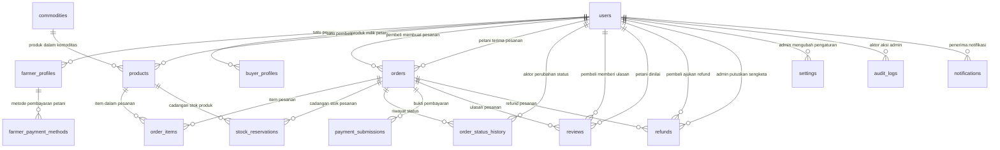

# Rancangan target MVP Panenku Backend

> Arsip rancangan pengembangan, bukan kontrak API yang sudah tersedia. Contoh refresh token, pembayaran, refund, admin, diagram kelas, dan tabel rencana di dokumen ini belum semuanya diimplementasikan. Gunakan [README backend](../README.md) untuk cara menjalankan dan endpoint aktual. Implementasi aktif diaudit pada branch backend; audit ini tidak mengubah frontend.

## 📋 Ringkasan Proyek

| Item | Detail |
|------|--------|
| Nama Aplikasi | Panenku |
| Target Platform | Android (REST API JSON) |
| Peran Pengguna | Pembeli, Petani, Admin |
| Pembayaran | QRIS / Transfer Bank ke rekening pribadi petani (manual verifikasi) |
| Komisi Platform | Tanpa komisi (Rp0) |
| Satuan Produk | Kilogram (kg), pecahan diperbolehkan (0.01 kg) |
| Limit Transaksi | Rp10.000.000 per checkout (termasuk ongkir) |
| Zona Waktu | WIB (Asia/Jakarta) |
| Database | PostgreSQL (ACID transactions) |
| File Storage | MinIO / AWS S3 (privat, tidak ada link publik permanen) |

---

## 🏗️ Arsitektur Backend

Kami menggunakan **Layered Architecture** dengan pemisahan kode berdasarkan **peran (role)**. Tidak menggunakan MVC murni karena backend hanya menyediakan REST API (tidak ada View/HTML rendering), dan logika bisnis terlalu kompleks untuk ditumpuk di Controller.

### Alur Permintaan

```
Android App → Routes → Controller → Service → Repository → Database
```

Setiap lapisan hanya boleh berkomunikasi dengan lapisan di bawahnya. Tidak boleh lompat layer.

### 4 Layer Utama

| Layer | Folder | Tanggung Jawab |
|-------|--------|----------------|
| **Controller** | `modules/{role}/controller/` | Terima request HTTP, validasi input sederhana, panggil Service, kirim JSON response |
| **Service** | `modules/{role}/service/` | **Logika bisnis inti** (aturan PRD & PDF): cek stok, hitung limit, state machine pesanan, verifikasi refund, dll |
| **Repository** | `modules/{role}/repository/` | Akses langsung ke database PostgreSQL, query SQL, transaksi ACID |
| **DTO** | `modules/{role}/dto/` | Wadah data request/response (jangan expose tabel database langsung ke Android) |

### Folder Pendukung

| Folder | Tanggung Jawab |
|--------|----------------|
| `common/` | Kode bersama semua role: JWT, exception handling, file storage, validasi decimal, idempotency |
| `config/` | Konfigurasi environment, database, JWT, server port |
| `scheduler/` | Background job (misal: kedaluwarsa pesanan 24 jam) |
| `routes/` | Definisi endpoint API + middleware auth & role guard |

---

## 📂 Struktur Folder

```text
backend/                              ← ROOT PROJECT (sudah ada)
├── build.gradle.kts                  ← Konfigurasi Gradle & dependencies
├── settings.gradle.kts
├── docker-compose.yml                ← PostgreSQL + MinIO (opsional)
├── Dockerfile
├── README.md                         ← File ini
└── src/
    └── main/
        └── kotlin/
            └── com/
                └── panenku/
                    └── backend/      ← Package root: com.panenku.backend
                        ├── Application.kt          ← Entry point, wiring semua module
                        ├── config/
                        │   └── AppConfig.kt        ← ENV, DB, JWT, MinIO, server port
                        │
                        ├── common/                 └─────── Shared semua role
                        │   ├── dto/
                        │   │   ├── ApiResponse.kt
                        │   │   └── ErrorResponse.kt
                        │   ├── exception/
                        │   │   ├── AppException.kt
                        │   │   └── ExceptionHandler.kt
                        │   ├── auth/
                        │   │   ├── JwtProvider.kt
                        │   │   └── JwtAuthProvider.kt
                        │   ├── security/
                        │   │   └── RoleGuard.kt
                        │   ├── storage/
                        │   │   └── FileStorage.kt
                        │   ├── validation/
                        │   │   └── DecimalValidator.kt
                        │   └── idempotency/
                        │       └── IdempotencyStore.kt
                        │
                        ├── modules/
                        │   ├── shared/             └─────── Digunakan semua role
                        │   │   ├── controller/   AuthController, UserController
                        │   │   ├── service/      AuthService, UserService
                        │   │   ├── repository/   UserRepository, AuthRepository
                        │   │   ├── dto/          RegisterRequest, LoginRequest, UserDTO
                        │   │   └── routes/       AuthRoutes, UserRoutes
                        │   │
                        │   ├── admin/            └─────── Role: Admin (pengelola)
                        │   │   ├── controller/   KtpVerification, UserManagement, Commodity, RefundDispute, Settings
                        │   │   ├── service/      KtpVerification, UserManagement, Commodity, RefundDispute, Settings, AuditLog
                        │   │   ├── repository/   KtpVerification, User, Commodity, Refund, Settings, AuditLog
                        │   │   ├── dto/          KtpVerifyRequest, SuspendUserRequest, LimitUpdateRequest, AuditLogDTO
                        │   │   └── routes/       AdminRoutes
                        │   │
                        │   ├── pembeli/          └─────── Role: Pembeli
                        │   │   ├── controller/   Catalog, Cart, Checkout, Order, PaymentProof, Review, Refund, Escalation, Notification
                        │   │   ├── service/      Catalog, Cart, Checkout, Order, PaymentSubmission, Review, Refund, Escalation, Notification
                        │   │   ├── repository/   Product, Cart, Order, OrderItem, StockReservation, PaymentSubmission, Review, Refund, Notification
                        │   │   ├── dto/          ProductCatalogDTO, CartItemRequest, CheckoutRequest, OrderDTO, PaymentProofRequest, RefundRequest, ReviewRequest
                        │   │   └── routes/       BuyerRoutes
                        │   │
                        │   └── petani/           └─────── Role: Petani
                        │       ├── controller/   Profile, Product, PaymentMethod, KtpApplication, Order, PaymentVerification, Fulfillment, RefundResponse
                        │       ├── service/      FarmerProfile, Product, PaymentMethod, KtpApplication, Order, PaymentVerification, Fulfillment, RefundResponse
                        │       ├── repository/   FarmerProfile, Product, PaymentMethod, KtpApplication, Order, PaymentSubmission, Refund
                        │       ├── dto/          FarmerProfileDTO, ProductRequest, PaymentMethodRequest, KtpApplicationRequest, OrderResponse, PaymentVerificationRequest, FulfillmentUpdateRequest, RefundResponseRequest
                        │       └── routes/       FarmerRoutes
                        │
                        └── scheduler/            └─────── Background job
                            └── ExpirationJob.kt    ← Kedaluwarsa 24 jam (server time)
        └── resources/
            └── application.conf

    └── test/
        └── kotlin/com/panenku/backend/
            ├── shared/
            ├── admin/
            ├── pembeli/
            ├── petani/
            └── integration/
```

> **Catatan:** `com/panenku/backend/` adalah package Kotlin (namespace), bukan project baru di dalam project. Semua kode tinggal di dalam folder `backend/` yang sudah ada.

---

## 👥 Pemisahan Per Role

| Role | Folder | Contoh Fungsi Utama |
|------|--------|---------------------|
| **Admin** | `modules/admin/` | Verifikasi KTP petani, suspend/pulihkan user, kelola komoditas, ubah limit transaksi, tiket eskalasi refund, audit log |
| **Pembeli** | `modules/pembeli/` | Katalog produk, keranjang, checkout, pesanan, upload bukti pembayaran, ulasan, refund, eskalasi |
| **Petani** | `modules/petani/` | Profil toko, produk & stok, metode pembayaran (QRIS/Bank), ajukan KTP, terima/tolak pesanan, verifikasi bukti, status pemenuhan, respons refund |
| **Shared** | `modules/shared/` | Register, login, logout, profil pengguna (digunakan semua role) |

---

## 📋 Aturan Bisnis (dari PRD & Laporan Praktikum)

Backend harus mengimplementasi aturan berikut:

1. **Stok atomik**: Pembuatan Order + cadangan stok dalam **satu transaksi database** (tidak ada oversell, tidak ada pesanan parsial).
2. **Stok tersedia** = stok fisik − stok yang sedang dicadangkan.
3. **Limit transaksi** Rp10.000.000 per checkout (termasuk ongkir). Total tepat limit = diterima, di atas limit = ditolak.
4. **Snapshot immutable**: Harga, ongkir, alamat, jadwal, rekening disalin saat checkout. Perubahan data setelahnya tidak mengubah transaksi lama.
5. **Bukti pembayaran ≠ lunas**: Petani harus memverifikasi bukti secara manual (terima/tolak dengan alasan).
6. **Setiap perubahan status pesanan** dicatat ke `order_status_history` dengan aktor dan waktu.
7. **Batas waktu 24 jam**: Respons petani & upload bukti pembayaran. Jika terlewati → pesanan kedaluwarsa, stok dicadangkan dilepas.
8. **Refund maksimal 1 pengajuan aktif per pesanan**. Nominal refund ≤ nominal pembayaran. Jendela maksimal 24 jam setelah `received_at` (kecuali pesanan gagal dipenuhi).
9. **File privat**: KTP, bukti pembayaran, bukti refund hanya bisa diakses pihak transaksi dan admin berwenang. Tidak ada link publik permanen.
10. **Decimal tepat**: Rupiah dan kg pakai `BIGINT` / `DECIMAL`, **bukan floating point biner**.
11. **Idempotensi**: Retry request jaringan tidak menghasilkan Order, Refund, atau Ulasan ganda.
12. **Role-Based Access Control**: Pembeli tidak bisa mengakses fungsi petani/admin. Admin tidak bisa didaftar melalui formulir publik.

---

## 🗄️ Skema Database Lengkap

### Konsep Umum

| Keputusan | Alasan |
|-----------|--------|
| Database | **PostgreSQL** (ACID, support `DECIMAL`, UUID, JSONB) |
| Primary Key | `UUID` untuk semua tabel |
| Waktu | `TIMESTAMPTZ`, zona referensi **WIB** (Asia/Jakarta) |
| Uang & Berat | `BIGINT` untuk rupiah (menghindari float), `DECIMAL(10,2)` untuk kg |
| File | Simpan **path/file ID** saja di DB, file fisik ada di MinIO/S3 (privat) |
| Transaksi | Order + StockReservation dalam **satu transaksi DB** (atomic) |

---

### ERD (Entity Relationship Diagram)



**Penjelasan singkat ERD:**
- `users` adalah tabel pusat untuk semua role (`pembeli`, `petani`, `admin`).
- Setiap role memiliki profil terpisah: `farmer_profiles` atau `buyer_profiles`.
- `orders` terhubung ke satu pembeli dan satu petani (satu petani per checkout).
- `order_items` dan `stock_reservations` menghubungkan pesanan dengan produk.
- `order_status_history` mencatat setiap perubahan status dengan siapa dan kapan.
- `payment_submissions`, `reviews`, dan `refunds` semua terhubung ke satu `orders`.

---

### Tabel & Kolom

#### 1. `users` — Akun semua role

| Kolom | Tipe | Keterangan |
|-------|------|------------|
| `id` | UUID PK | |
| `email` | VARCHAR(255) UNIQUE NOT NULL | Login |
| `password_hash` | VARCHAR(255) NOT NULL | bcrypt / argon2 |
| `role` | VARCHAR(20) NOT NULL | `pembeli` / `petani` / `admin` |
| `status` | VARCHAR(20) NOT NULL DEFAULT 'active' | `active` / `suspended` |
| `created_at` | TIMESTAMPTZ DEFAULT now() | |
| `updated_at` | TIMESTAMPTZ DEFAULT now() | |

**Constraint:** `role` CHECK IN ('pembeli','petani','admin'), `status` CHECK IN ('active','suspended')

---

#### 2. `farmer_profiles` — Profil petani

| Kolom | Tipe | Keterangan |
|-------|------|------------|
| `id` | UUID PK → users.id | |
| `store_name` | VARCHAR(255) NOT NULL | Nama toko |
| `contact_phone` | VARCHAR(20) | Kontak petani (digunakan admin untuk kontak verifikasi KTP) |
| `pickup_location` | TEXT | Lokasi pengambilan (ambil sendiri) |
| `service_area` | TEXT | Daftar kecamatan layanan antar (bukan radius GPS) |
| `delivery_fee` | BIGINT NOT NULL DEFAULT 0 | Ongkir tetap per pesanan (rupiah) |
| `shipping_enabled` | BOOLEAN NOT NULL DEFAULT false | Aktifkan layanan antar? |
| `ktp_status` | VARCHAR(20) NOT NULL DEFAULT 'belum_diajukan' | `belum_diajukan` / `menunggu` / `disetujui` / `ditolak` |
| `ktp_rejection_reason` | TEXT | Alasan penolakan (wajib jika ditolak) |
| `ktp_document_path` | VARCHAR(512) | Path file KTP dummy di MinIO (privat) |
| `ktp_submitted_at` | TIMESTAMPTZ NULL | |
| `ktp_reviewed_at` | TIMESTAMPTZ NULL | |
| `ktp_reviewed_by` | UUID → users.id | Admin yang memutuskan |
| `created_at` / `updated_at` | TIMESTAMPTZ | |

**Aturan:** `ktp_status` dan `users.status` (suspend) adalah **dua atribut terpisah**. Petani yang KTP-nya disetujui tapi sedang `suspended` tetap tidak bisa terima pesanan baru.

---

#### 3. `buyer_profiles` — Profil pembeli

| Kolom | Tipe | Keterangan |
|-------|------|------------|
| `id` | UUID PK → users.id | |
| `full_name` | VARCHAR(255) NOT NULL | |
| `contact_phone` | VARCHAR(20) | |
| `delivery_address` | TEXT | Alamat untuk pengantaran |
| `created_at` / `updated_at` | TIMESTAMPTZ | |

---

#### 4. `commodities` — Komoditas sayuran

| Kolom | Tipe | Keterangan |
|-------|------|------------|
| `id` | UUID PK | |
| `name` | VARCHAR(100) NOT NULL UNIQUE | Nama komoditas (cabai, tomat, sawi, dll) |
| `is_active` | BOOLEAN NOT NULL DEFAULT true | Nonaktifkan komoditas bermasalah |
| `created_at` / `updated_at` | TIMESTAMPTZ | |

**Aturan:** Komoditas yang sudah ada transaksi jangan dihapus (hanya nonaktifkan). Snapshot pesanan tetap tampilkan nama komoditas asal.

---

#### 5. `products` — Produk petani

| Kolom | Tipe | Keterangan |
|-------|------|------------|
| `id` | UUID PK | |
| `farmer_id` | UUID NOT NULL → users.id | Pemilik produk |
| `commodity_id` | UUID NOT NULL → commodities.id | |
| `name` | VARCHAR(255) NOT NULL | Nama produk |
| `description` | TEXT | Opsional: kondisi, asal, catatan penyimpanan |
| `photo_url` | VARCHAR(512) | Path foto produk di MinIO (privat) |
| `price_per_kg` | BIGINT NOT NULL CHECK (> 0) | Harga per kg (rupiah) |
| `stock_physical` | DECIMAL(10,2) NOT NULL DEFAULT 0 | Stok fisik (kg) |
| `stock_reserved` | DECIMAL(10,2) NOT NULL DEFAULT 0 | Stok sedang dicadangkan |
| `ready_date` | DATE NOT NULL | Tanggal paling awal tersedia |
| `publication_status` | VARCHAR(20) NOT NULL DEFAULT 'draft' | `draft` / `aktif` / `nonaktif` |
| `created_at` / `updated_at` | TIMESTAMPTZ | |

**Aturan bisnis:**
- Produk aktif memerlukan `farmer_profiles` lokasi lengkap + minimal 1 metode pembayaran lengkap.
- Petani tidak boleh mengurangi `stock_physical` di bawah total `stock_reserved` aktif.
- Stok tersedia = `stock_physical − stock_reserved`.
- Produk `nonaktif` atau `draft` tidak bisa masuk checkout baru.

---

#### 6. `farmer_payment_methods` — Metode pembayaran petani

| Kolom | Tipe | Keterangan |
|-------|------|------------|
| `id` | UUID PK | |
| `farmer_id` | UUID NOT NULL → users.id | |
| `method_type` | VARCHAR(20) NOT NULL | `qris` / `bank_transfer` |
| `qris_image_path` | VARCHAR(512) | Path gambar QRIS (untuk method_type=qris) |
| `bank_name` | VARCHAR(100) | Nama bank (untuk bank_transfer) |
| `account_number` | VARCHAR(50) NOT NULL | Teks, agar nol di depan tidak hilang |
| `account_holder_name` | VARCHAR(255) NOT NULL | Nama pemilik rekening |
| `created_at` / `updated_at` | TIMESTAMPTZ | |

**Aturan:** Minimal satu metode lengkap sebelum produk dapat diaktifkan. Nomor rekening disimpan sebagai teks.

---

#### 7. `orders` — Pesanan utama

| Kolom | Tipe | Keterangan |
|-------|------|------------|
| `id` | UUID PK | |
| `buyer_id` | UUID NOT NULL → users.id | |
| `farmer_id` | UUID NOT NULL → users.id | Satu petani per checkout |
| `fulfillment_method` | VARCHAR(20) NOT NULL | `pickup` / `delivery` |
| `delivery_fee` | BIGINT NOT NULL DEFAULT 0 | **Snapshot** ongkir saat checkout |
| `subtotal_items` | BIGINT NOT NULL | **Snapshot** subtotal produk |
| `total_payment` | BIGINT NOT NULL | **Snapshot** subtotal + ongkir |
| `transaction_limit_applied` | BIGINT NOT NULL | Limit yang berlaku saat checkout (Rp10 juta default) |
| `order_status` | VARCHAR(30) NOT NULL DEFAULT 'menunggu_petani' | Lihat state machine di bawah |
| `payment_status` | VARCHAR(20) NOT NULL DEFAULT 'belum_dibayar' | `belum_dibayar` / `menunggu_verifikasi` / `bukti_ditolak` / `terverifikasi` |
| `scheduled_date` | DATE NOT NULL | Tanggal pengambilan/pengantaran |
| `scheduled_time_slot` | VARCHAR(100) | Rentang waktu yang dipilih pembeli |
| `pickup_location_snapshot` | TEXT | Lokasi pengambilan saat checkout |
| `delivery_address_snapshot` | TEXT | Alamat pengantaran saat checkout |
| `buyer_notes` | TEXT | Catatan pembeli |
| `received_at` | TIMESTAMPTZ NULL | Waktu pembeli konfirmasi penerimaan |
| `reserved_at` | TIMESTAMPTZ DEFAULT now() | Waktu cadangan stok dibuat |
| `expires_at` | TIMESTAMPTZ NOT NULL | Batas respons 24 jam |
| `created_at` / `updated_at` | TIMESTAMPTZ | |

**Aturan:**
- Semua kolom `*_snapshot` diisi saat checkout dan **tidak boleh berubah** meski produk/profil nanti diubah.
- `total_payment` = subtotal + ongkir, harus ≤ `transaction_limit_applied`.
- Satu petani per checkout (scope CART01).

---

#### 8. `order_items` — Item pesanan

| Kolom | Tipe | Keterangan |
|-------|------|------------|
| `id` | UUID PK | |
| `order_id` | UUID NOT NULL → orders.id | |
| `product_id` | UUID NOT NULL → products.id | |
| `product_name_snapshot` | VARCHAR(255) | Nama produk saat checkout |
| `commodity_snapshot` | VARCHAR(100) | Komoditas saat checkout |
| `quantity_kg` | DECIMAL(10,2) NOT NULL CHECK (> 0) | Jumlah kg (pecahan diperbolehkan, min 0.01) |
| `price_per_kg_snapshot` | BIGINT NOT NULL | Harga per kg saat checkout |
| `item_subtotal` | BIGINT NOT NULL | quantity_kg × price_per_kg, dibulatkan half-up ke rupiah |
| `created_at` | TIMESTAMPTZ | |

---

#### 9. `stock_reservations` — Cadangan stok

| Kolom | Tipe | Keterangan |
|-------|------|------------|
| `id` | UUID PK | |
| `product_id` | UUID NOT NULL → products.id | |
| `order_id` | UUID NOT NULL → orders.id | |
| `quantity_kg` | DECIMAL(10,2) NOT NULL | |
| `status` | VARCHAR(20) NOT NULL DEFAULT 'active' | `active` / `released` / `fulfilled` |
| `reserved_at` | TIMESTAMPTZ DEFAULT now() | |
| `released_at` | TIMESTAMPTZ NULL | Dilepas jika batal/ditolak/kedaluwarsa |
| `fulfilled_at` | TIMESTAMPTZ NULL | Terpenuhi saat barang diserahkan/diantar |

**Aturan:** Setiap cadangan dilepas **tepat satu kali**. Jika pesanan ditolak/dibatalkan/kedaluwarsa/gagal dipenuhi → cadangan dilepas sekali.

---

#### 10. `order_status_history` — Riwayat status pesanan

| Kolom | Tipe | Keterangan |
|-------|------|------------|
| `id` | UUID PK | |
| `order_id` | UUID NOT NULL → orders.id | |
| `from_status` | VARCHAR(30) NULL | |
| `to_status` | VARCHAR(30) NOT NULL | |
| `actor_id` | UUID NOT NULL → users.id | Siapa yang mengubah |
| `actor_role` | VARCHAR(20) NOT NULL | `pembeli` / `petani` / `admin` |
| `changed_at` | TIMESTAMPTZ DEFAULT now() | |
| `note` | TEXT | Catatan/alasan perubahan |

---

#### 11. `payment_submissions` — Bukti pembayaran

| Kolom | Tipe | Keterangan |
|-------|------|------------|
| `id` | UUID PK | |
| `order_id` | UUID NOT NULL → orders.id | |
| `payment_method` | VARCHAR(20) NOT NULL | `qris` / `bank_transfer` |
| `recipient_snapshot` | JSONB NOT NULL | Snapshot penerima: nama bank, norek, nama pemilik, info QRIS |
| `total_amount` | BIGINT NOT NULL | Nominal yang ditransfer |
| `proof_image_path` | VARCHAR(512) | Path foto bukti di MinIO (privat) |
| `status` | VARCHAR(20) NOT NULL DEFAULT 'menunggu_verifikasi' | `menunggu_verifikasi` / `bukti_ditolak` / `terverifikasi` |
| `farmer_decision` | VARCHAR(20) NULL | `terima` / `tolak` |
| `farmer_decision_reason` | TEXT | Alasan jika ditolak |
| `farmer_decided_at` | TIMESTAMPTZ NULL | |
| `submitted_at` | TIMESTAMPTZ DEFAULT now() | |
| `updated_at` | TIMESTAMPTZ | |

**Aturan:**
- Hanya petani pemilik pesanan yang dapat memverifikasi.
- Riwayat bukti dan keputusan disimpan (tidak double verification/stok).
- Bukti ditolak → kembali ke `menunggu_pembayaran` dengan batas 24 jam baru, bukti lama tetap tercatat.

---

#### 12. `reviews` — Ulasan pembeli

| Kolom | Tipe | Keterangan |
|-------|------|------------|
| `id` | UUID PK | |
| `order_id` | UUID NOT NULL UNIQUE → orders.id | Satu ulasan per pesanan |
| `buyer_id` | UUID NOT NULL → users.id | |
| `farmer_id` | UUID NOT NULL → users.id | |
| `rating` | INTEGER NOT NULL CHECK BETWEEN 1 AND 5 | Bintang wajib |
| `comment` | VARCHAR(500) | Opsional, maks 500 karakter |
| `created_at` | TIMESTAMPTZ | |

**Aturan:** Hanya bisa ulasan setelah pesanan `selesai`. Rating petani = rata-rata ulasan valid.

---

#### 13. `refunds` — Pengajuan refund

| Kolom | Tipe | Keterangan |
|-------|------|------------|
| `id` | UUID PK | |
| `order_id` | UUID NOT NULL → orders.id | |
| `buyer_id` | UUID NOT NULL → users.id | |
| `reason` | TEXT NOT NULL | Alasan refund |
| `evidence_photo_path` | VARCHAR(512) | Foto bukti (opsional) |
| `refund_amount` | BIGINT NOT NULL | Nominal refund penuh (produk + ongkir), ≤ pembayaran |
| `destination_type` | VARCHAR(20) NOT NULL | `bank` / `e-wallet` |
| `destination_provider` | VARCHAR(100) | Nama penyedia |
| `destination_account` | VARCHAR(100) | Nomor tujuan |
| `destination_name` | VARCHAR(255) | Nama penerima |
| `status` | VARCHAR(20) NOT NULL DEFAULT 'diajukan' | Lihat state machine di bawah |
| `farmer_response_reason` | TEXT | Alasan jika petani tolak |
| `farmer_proof_transfer_path` | VARCHAR(512) | Bukti transfer balik petani |
| `farmer_approved_at` | TIMESTAMPTZ NULL | |
| `buyer_confirmed_at` | TIMESTAMPTZ NULL | Pembeli konfirmasi dana masuk |
| `escalated_at` | TIMESTAMPTZ NULL | Waktu eskalasi ke admin |
| `escalation_reason` | TEXT | |
| `admin_decision` | TEXT | Keputusan admin (suspend / tutup tiket) |
| `admin_decided_by` | UUID → users.id | |
| `admin_decided_at` | TIMESTAMPTZ NULL | |
| `created_at` / `updated_at` | TIMESTAMPTZ | |

**Aturan:**
- Maksimal satu pengajuan aktif per pesanan.
- Jendela maksimal 24 jam setelah `received_at` (kecuali pesanan gagal dipenuhi tanpa received_at).
- Status setelah unggah bukti transfer balik = `menunggu_konfirmasi_dana`, bukan `selesai`.
- Hanya selesai setelah pembeli tekan "Dana sudah diterima".

---

#### 14. `settings` — Pengaturan admin

| Kolom | Tipe | Keterangan |
|-------|------|------------|
| `id` | UUID PK | |
| `setting_key` | VARCHAR(100) UNIQUE NOT NULL | `transaction_limit`, `cs_whatsapp`, `expiry_hours` |
| `setting_value` | TEXT NOT NULL | Misal: `10000000` |
| `changed_by` | UUID → users.id | Admin yang mengubah |
| `changed_at` | TIMESTAMPTZ DEFAULT now() | |
| `reason` | TEXT | Alasan perubahan |

**Aturan:** Nilai, alasan, admin, waktu perubahan dicatat. Batas baru hanya berlaku pada pesanan baru (snapshot pada pesanan lama tidak berubah).

---

#### 15. `audit_logs` — Rekam jejak admin

| Kolom | Tipe | Keterangan |
|-------|------|------------|
| `id` | UUID PK | |
| `actor_id` | UUID NOT NULL → users.id | |
| `actor_role` | VARCHAR(20) NOT NULL | |
| `action` | VARCHAR(100) NOT NULL | `verify_ktp`, `suspend_user`, `change_limit`, `close_dispute`, dll |
| `target_type` | VARCHAR(50) | `user`, `order`, `refund`, `product`, `commodity` |
| `target_id` | UUID | ID target aksi |
| `old_values` | JSONB | Data sebelum berubah |
| `new_values` | JSONB | Data setelah berubah |
| `reason` | TEXT | Alasan aksi admin |
| `created_at` | TIMESTAMPTZ DEFAULT now() | |

---

#### 16. `notifications` — Notifikasi in-app

| Kolom | Tipe | Keterangan |
|-------|------|------------|
| `id` | UUID PK | |
| `user_id` | UUID NOT NULL → users.id | Penerima notifikasi |
| `title` | VARCHAR(255) NOT NULL | |
| `body` | TEXT | |
| `type` | VARCHAR(50) | `order`, `payment`, `refund`, `system` |
| `is_read` | BOOLEAN NOT NULL DEFAULT false | |
| `deep_link` | VARCHAR(512) | Layar tujuan di Android |
| `created_at` | TIMESTAMPTZ DEFAULT now() | |

---

### State Machines (Status)

#### Order Status (`orders.order_status`)

```
menunggu_petani
    ├─ petani terima ──→ menunggu_pembayaran
    ├─ petani tolak ──→ ditolak (stok dilepas)
    ├─ pembeli batal ──→ dibatalkan (stok dilepas)
    └─ kedaluwarsa 24 jam ──→ kedaluwarsa (stok dilepas)

menunggu_pembayaran
    ├─ pembeli upload bukti ──→ verifikasi_pembayaran
    └─ kedaluwarsa 24 jam ──→ kedaluwarsa

verifikasi_pembayaran
    ├─ petani terima bukti ──→ diproses
    ├─ petani tolak bukti ──→ menunggu_pembayaran (batas baru 24 jam)
    └─ (belum auto-expire saat verifikasi berlangsung)

diproses
    ├─ pickup: petani siap diambil ──→ siap_diambil
    ├─ delivery: petani mulai antar ──→ diantar
    └─ petani gagal dipenuhi ──→ gagal_dipenuhi (refund tersedia)

siap_diambil / diantar
    ├─ petani tandai diterima/tiba ──→ menunggu_penerimaan

menunggu_penerimaan
    ├─ pembeli konfirmasi ──→ selesai (received_at dicatat)
    └─ laporkan kendala ──→ refund / eskalasi
```

**Aturan transisi:** Hanya transisi yang sah sesuai `fulfillment_method`. Setiap perubahan dicatat ke `order_status_history`.

#### Payment Status (`payment_submissions.status`)

```
belum_dibayar → menunggu_verifikasi → bukti_ditolak → (ulangi upload) → menunggu_verifikasi
                                           ↳ terverifikasi → order berubah ke diproses
```

#### Refund Status (`refunds.status`)

```
diajukan → disetujui → menunggu_konfirmasi_dana → selesai
   ↳ ditolak ←──┬──────→ dieskalasi ←── admin review
   ↳ dieskalasi ←──────────────────────────────┘
   ↳ ditutup_admin ←── admin putuskan
```

#### KTP Status (`farmer_profiles.ktp_status`)

```
belum_diajukan → menunggu → disetujui
                  ↳ ditolak → (perbaiki & ajukan ulang) → menunggu
```

**Catatan:** `ktp_status` terpisah dari `users.status` (active/suspended).

---

## 🏛️ Class Diagram

Diagram kelas di bawah ini menunjukkan struktur class Kotlin, relasi antar kelas, dan pola arsitektur yang digunakan (Layered Architecture: Controller → Service → Repository → Database).

```mermaid
classDiagram
    %% ================================================================
    %% LAYERED ARCHITECTURE PATTERN (Controller -> Service -> Repository)
    %% ================================================================

    class AuthController {
        <<REST Controller>>
        +register(RegisterRequest)
        +login(LoginRequest)
        +logout()
    }

    class AuthService {
        <<Service>>
        +authenticate(email, password)
        +generateJWT(User)
        +validateToken(token)
    }

    class UserRepository {
        <<JpaRepository>>
        +findByEmail(email)
        +existsByEmail(email)
        +save(User)
    }

    class User {
        <<Entity>>
        -id: UUID
        -email: String
        -passwordHash: String
        -role: Role
        -status: AccountStatus
        -createdAt: LocalDateTime
    }

    AuthController ..> AuthService : uses
    AuthService ..> UserRepository : uses
    AuthService ..> User : manages
    UserRepository ..> User : persists

    %% ================================================================
    %% CORE DOMAIN: USER & PROFILES (1:1)
    %% ================================================================

    class FarmerProfile {
        <<Entity>>
        -id: UUID
        -storeName: String
        -contactPhone: String
        -pickupLocation: String
        -serviceArea: String
        -deliveryFee: Long
        -shippingEnabled: Boolean
        -ktpStatus: KTPStatus
        -ktpDocumentPath: String
    }

    class BuyerProfile {
        <<Entity>>
        -id: UUID
        -fullName: String
        -contactPhone: String
        -deliveryAddress: String
    }

    User "1" *-- "0..1" FarmerProfile : has profile
    User "1" *-- "0..1" BuyerProfile : has profile
    FarmerProfile ..> User : linked to
    BuyerProfile ..> User : linked to

    %% ================================================================
    %% CORE DOMAIN: PRODUCT & COMMODITY
    %% ================================================================

    class Commodity {
        <<Entity>>
        -id: UUID
        -name: String
        -isActive: Boolean
    }

    class Product {
        <<Entity>>
        -id: UUID
        -name: String
        -pricePerKg: Long
        -stockPhysical: BigDecimal
        -stockReserved: BigDecimal
        -readyDate: LocalDate
        -publicationStatus: ProductStatus
    }

    class FarmerPaymentMethod {
        <<Entity>>
        -id: UUID
        -methodType: PaymentMethodType
        -accountNumber: String
        -accountHolderName: String
    }

    Commodity "1" *-- "0..*" Product : categorizes
    Product "1" *-- "0..*" FarmerPaymentMethod : offers
    FarmerProfile "1" *-- "0..*" Product : owns
    FarmerProfile "1" *-- "0..*" FarmerPaymentMethod : has

    %% ================================================================
    %% CORE DOMAIN: ORDER & ITEM
    %% ================================================================

    class Order {
        <<Entity>>
        -id: UUID
        -totalPayment: Long
        -orderStatus: OrderStatus
        -paymentStatus: PaymentStatus
        -scheduledDate: LocalDate
        -expiresAt: LocalDateTime
    }

    class OrderItem {
        <<Entity>>
        -id: UUID
        -quantityKg: BigDecimal
        -pricePerKgSnapshot: Long
        -itemSubtotal: Long
    }

    class StockReservation {
        <<Entity>>
        -id: UUID
        -quantityKg: BigDecimal
        -status: ReservationStatus
    }

    class OrderStatusHistory {
        <<Entity>>
        -id: UUID
        -fromStatus: OrderStatus
        -toStatus: OrderStatus
        -changedAt: LocalDateTime
    }

    BuyerProfile "1" *-- "0..*" Order : places
    FarmerProfile "1" *-- "0..*" Order : receives
    Order "1" *-- "0..*" OrderItem : contains
    Order "1" *-- "0..*" StockReservation : reserves
    Order "1" *-- "0..*" OrderStatusHistory : tracks

    %% ================================================================
    %% CORE DOMAIN: PAYMENT & REFUND
    %% ================================================================

    class PaymentSubmission {
        <<Entity>>
        -id: UUID
        -paymentMethod: PaymentMethodType
        -proofImagePath: String
        -status: PaymentSubmissionStatus
    }

    class Review {
        <<Entity>>
        -id: UUID
        -rating: Integer
        -comment: String
    }

    class Refund {
        <<Entity>>
        -id: UUID
        -refundAmount: Long
        -status: RefundStatus
    }

    Order "1" *-- "0..1" PaymentSubmission : has
    Order "1" *-- "0..1" Review : receives
    Order "1" *-- "0..*" Refund : generates
    BuyerProfile "1" *-- "0..*" Refund : requests

    %% ================================================================
    %% ADMIN DOMAIN
    %% ================================================================

    class Settings {
        <<Entity>>
        -id: UUID
        -settingKey: String
        -settingValue: String
    }

    class AuditLog {
        <<Entity>>
        -id: UUID
        -action: String
        -actorRole: Role
        -createdAt: LocalDateTime
    }

    class Notification {
        <<Entity>>
        -id: UUID
        -title: String
        -body: String
        -isRead: Boolean
    }

    User "1" *-- "0..*" AuditLog : performs
    User "1" *-- "0..*" Notification : receives
    Settings "1" *-- "0..1" User : changed by

    %% ================================================================
    %% SERVICE LAYER (representative)
    %% ================================================================

    class CheckoutService {
        <<Service>>
        +createOrder(CheckoutRequest)
        +validateStock()
        +validateLimit()
    }

    class OrderRepository {
        <<JpaRepository>>
        +findByBuyerId(UUID)
        +findByFarmerId(UUID)
    }

    class KtpVerificationService {
        <<Service>>
        +verifyKTP(farmerId, approved)
    }

    class RefundService {
        <<Service>>
        +requestRefund(orderId, reason)
        +escalateToAdmin(refundId)
    }

    CheckoutService ..> OrderRepository : uses
    CheckoutService ..> Order : manages
    CheckoutService ..> StockReservation : manages
    KtpVerificationService ..> FarmerProfile : manages
    RefundService ..> Refund : manages

    %% ================================================================
    %% CONTROLLER LAYER (representative)
    %% ================================================================

    class CheckoutController {
        <<REST Controller>>
        +checkout(CheckoutRequest)
    }

    class OrderController {
        <<REST Controller>>
        +listOrders()
        +updateStatus(UUID, FulfillmentUpdateRequest)
    }

    CheckoutController ..> CheckoutService : calls
    OrderController ..> OrderService : calls

    %% ================================================================
    %% COMMON / CROSS-CUTTING
    %% ================================================================

    class JwtProvider {
        <<Utility>>
        +generateToken(User)
        +validateToken(String)
    }

    class RoleGuard {
        <<Filter>>
        +hasRole(role)
    }

    class ExceptionHandler {
        <<Controller Advice>>
        +handleException(Exception)
    }

    class ApiResponse {
        <<DTO>>
        -success: Boolean
        -data: Object
        -message: String
    }

    AuthController ..> JwtProvider : uses
    AuthController ..> RoleGuard : uses
    CheckoutController ..> ExceptionHandler : handled by
    CheckoutController ..> ApiResponse : returns

    %% ================================================================
    %% DTO LAYER
    %% ================================================================

    class CheckoutRequest {
        <<DTO>>
        -items: List~CheckoutItemRequest~
        -fulfillmentMethod: String
        -scheduledDate: LocalDate
    }

    class OrderDTO {
        <<DTO>>
        -id: UUID
        -totalPayment: Long
        -status: OrderStatus
    }

    CheckoutController ..> CheckoutRequest : receives
    OrderController ..> OrderDTO : returns
```



### Notasi yang Digunakan

| Notasi | Arti | Contoh di Diagram |
|--------|------|-------------------|
| `<<Entity>>` | Kelas yang dipetakan ke tabel database (JPA/Hibernate) | `User`, `Order`, `Product` |
| `<<Service>>` | Kelas berisi logika bisnis (aturan PRD & PDF) | `AuthService`, `CheckoutService` |
| `<<REST Controller>>` | Kelas yang menangani endpoint HTTP / JSON | `AuthController`, `CheckoutController` |
| `<<JpaRepository>>` | Interface Spring Data JPA untuk akses DB | `UserRepository`, `OrderRepository` |
| `<<DTO>>` | Data Transfer Object untuk request/response | `CheckoutRequest`, `OrderDTO` |
| `<<Utility>>` / `<<Filter>>` / `<<Controller Advice>>` | Komponen penunjang umum | `JwtProvider`, `RoleGuard`, `ExceptionHandler` |
| `..|>` | Implementasi interface | `UserRepository ..|> JpaRepository` |
| `*--` | Komposisi (milik, tidak bisa berdiri sendiri) | `Order *-- OrderItem` |
| `o--` | Asosiasi (terhubung tapi independen) | `User o-- FarmerProfile` |
| `..>` | Dependency / penggunaan | `Controller ..> Service` |
| `"1" *-- "0..*"` | Multiplicity (satu punya banyak, nol hingga banyak) | Buyer memiliki banyak Order |

### Relasi Penting dalam Sistem

| Relasi | Keterangan |
|--------|------------|
| `User` → `FarmerProfile` (1:1) | Setiap petani punya satu profil toko |
| `User` → `BuyerProfile` (1:1) | Setiap pembeli punya satu profil pembeli |
| `User` → `Product` (1:N) | Satu petani bisa punya banyak produk |
| `Commodity` → `Product` (1:N) | Satu komoditas bisa ada banyak produk |
| `Order` → `OrderItem` (1:N) | Satu pesanan bisa terdiri dari banyak item |
| `Order` → `StockReservation` (1:N) | Setiap pesanan mencadangkan stok satu atau lebih produk |
| `Order` → `PaymentSubmission` (1:1) | Satu pesanan memiliki satu bukti pembayaran |
| `Order` → `Refund` (1:N) | Satu pesanan bisa memiliki beberapa pengajuan refund |
| `User` → `AuditLog` (1:N) | Setiap aksi admin dicatat dalam audit log |

### Pola Antar Layer

```
Android App
    │ HTTP Request
    ▼
[Controller] ─────────► [Service] ─────────► [Repository] ─────────► [Database]
   (Endpoint)            (Logika Bisnis)     (Query SQL / JPA)     (PostgreSQL)
```

Setiap **Controller** hanya boleh memanggil **Service**. Setiap **Service** hanya boleh memanggil **Repository** dan mengelola **Entity**. Tidak ada Controller yang langsung akses Database.

---

### Aturan Database (Constraints & Business Rules)

| No | Aturan | Implementasi |
|----|--------|--------------|
| 1 | Stok atomik: Order + Reservation dalam satu transaksi | Transaksi aplikasi (BEGIN/COMMIT) |
| 2 | Tidak oversell: `stock_physical − stock_reserved ≥ 0` | `SELECT ... FOR UPDATE` (pessimistic locking) di service |
| 3 | Limit Rp10 juta: `total_payment ≤ transaction_limit_applied` | Validasi service |
| 4 | Snapshot immutable: kolom `*_snapshot` tidak diubah setelah dibuat | Validasi service |
| 5 | Satu review per pesanan | `UNIQUE(order_id)` di tabel `reviews` |
| 6 | Satu refund aktif per pesanan | Validasi service sebelum INSERT `refunds` |
| 7 | Decimal tepat | `BIGINT` untuk rupiah, `DECIMAL(10,2)` untuk kg |
| 8 | File privat | Simpan path saja di DB, file fisik di MinIO/S3 |
| 9 | KTP status & suspend terpisah | Dua kolom berbeda, dicek gabungan |
| 10 | Admin tidak bisa didaftar publik | Role `admin` hanya bisa dibuat via proses pengelola |

---

### Index yang Disarankan

| Tabel | Kolom | Alasan |
|-------|-------|--------|
| `users` | `email` | Login cepat |
| `users` | `role` | Filter per role |
| `products` | `farmer_id` | Produk milik petani |
| `products` | `commodity_id` | Filter katalog |
| `products` | `publication_status` | Katalog hanya aktif |
| `orders` | `buyer_id` | Riwayat pembeli |
| `orders` | `farmer_id` | Pesanan masuk petani |
| `orders` | `order_status` | Antrean pesanan |
| `stock_reservations` | `product_id` + `status` | Cek cadangan aktif |
| `payment_submissions` | `order_id` | Bukti per pesanan |
| `refunds` | `order_id` + `status` | Refund aktif per pesanan |
| `audit_logs` | `created_at` | Laporan admin |
| `notifications` | `user_id` + `is_read` | Notifikasi pembeli/petani/admin |

---

### Catatan Implementasi

1. **Tidak ada foreign key ke file fisik**: `photo_url`, `proof_image_path`, `qris_image_path`, `ktp_document_path` hanya menyimpan string path di MinIO/S3.
2. **Relasi self-referensi**: `audit_logs.admin_decided_by` dan `farmer_profiles.ktp_reviewed_by` merujuk ke `users(id)`.
3. **Riwayat transaksi**: implementasi aktif tidak memakai cascade delete untuk pesanan. Foreign key mempertahankan referensi dan trigger melindungi snapshot item dari update/delete; pesanan diproses melalui perubahan status.

---

## 📡 Spesifikasi API Endpoint

Semua endpoint menggunakan prefix `/api/v1`. Autentikasi menggunakan header `Authorization: Bearer <access_token>`. Format respons standar: `ApiResponse` dengan field `success`, `data`, `message`, dan `timestamp`.

### 1. Auth & User (Shared — Semua Role)

| Method | Endpoint | Deskripsi | Akses |
|--------|----------|-----------|-------|
| POST | `/auth/register` | Daftar akun (pilih role pembeli atau petani) | Publik |
| POST | `/auth/login` | Login, terima access + refresh token | Publik |
| POST | `/auth/logout` | Invalidate refresh token | Semua role |
| POST | `/auth/refresh` | Refresh access token | Publik |
| GET | `/auth/me` | Lihat profil sendiri (tanpa sensitive data) | Semua role |
| PUT | `/auth/profile` | Update profil sendiri | Semua role |

### 2. Pembeli

| Method | Endpoint | Deskripsi | Akses |
|--------|----------|-----------|-------|
| GET | `/buyer/products` | Katalog produk (cari, filter komoditas, urut harga) | Pembeli |
| GET | `/buyer/products/{id}` | Detail produk + info petani + ulasan | Pembeli |
| GET | `/buyer/commodities` | Daftar komoditas aktif | Pembeli |
| POST | `/buyer/cart/items` | Tambah item ke keranjang | Pembeli |
| GET | `/buyer/cart` | Lihat isi keranjang | Pembeli |
| PUT | `/buyer/cart/items/{id}` | Ubah jumlah item keranjang | Pembeli |
| DELETE | `/buyer/cart/items/{id}` | Hapus item dari keranjang | Pembeli |
| POST | `/buyer/checkout` | Buat pesanan (stok atomik + validasi limit) | Pembeli |
| GET | `/buyer/orders` | Daftar pesanan sendiri | Pembeli |
| GET | `/buyer/orders/{id}` | Detail pesanan + snapshot | Pembeli |
| POST | `/buyer/orders/{id}/cancel` | Batal pesanan (hanya status menunggu petani) | Pembeli |
| POST | `/buyer/orders/{id}/payment-proof` | Upload bukti pembayaran (foto) | Pembeli |
| POST | `/buyer/orders/{id}/receive` | Konfirmasi penerimaan barang | Pembeli |
| POST | `/buyer/orders/{id}/review` | Tulis ulasan (hanya setelah selesai, 1 per pesanan) | Pembeli |
| POST | `/buyer/refunds` | Ajukan refund (maksimal 1 aktif per pesanan) | Pembeli |
| GET | `/buyer/refunds` | Daftar refund sendiri | Pembeli |
| POST | `/buyer/escalations` | Buat tiket eskalasi ke admin | Pembeli |
| GET | `/buyer/notifications` | Daftar notifikasi dalam aplikasi | Pembeli |
| PUT | `/buyer/notifications/{id}/read` | Tandai notifikasi dibaca | Pembeli |

### 3. Petani

| Method | Endpoint | Deskripsi | Akses |
|--------|----------|-----------|-------|
| GET | `/petani/profile` | Lihat profil toko sendiri | Petani |
| PUT | `/petani/profile` | Update profil toko (lokasi, area, ongkir) | Petani |
| POST | `/petani/payment-methods` | Tambah QRIS atau rekening bank | Petani |
| GET | `/petani/payment-methods` | Lihat metode pembayaran sendiri | Petani |
| PUT | `/petani/payment-methods/{id}` | Update metode pembayaran | Petani |
| DELETE | `/petani/payment-methods/{id}` | Hapus metode pembayaran | Petani |
| POST | `/petani/products` | Tambah produk (butuh KTP disetujui) | Petani |
| GET | `/petani/products` | Daftar produk sendiri | Petani |
| GET | `/petani/products/{id}` | Detail produk sendiri | Petani |
| PUT | `/petani/products/{id}` | Update produk (stok, harga, ready_date, status) | Petani |
| DELETE | `/petani/products/{id}` | Nonaktifkan produk | Petani |
| POST | `/petani/ktp/application` | Ajukan verifikasi KTP dummy | Petani |
| GET | `/petani/ktp/status` | Lihat status verifikasi KTP | Petani |
| GET | `/petani/orders` | Daftar pesanan masuk toko sendiri | Petani |
| GET | `/petani/orders/{id}` | Detail pesanan masuk | Petani |
| PUT | `/petani/orders/{id}/respond` | Terima atau tolak pesanan dengan alasan | Petani |
| PUT | `/petani/orders/{id}/payment-verify` | Verifikasi bukti pembayaran (terima/tolak) | Petani |
| PUT | `/petani/orders/{id}/fulfillment` | Update status pemenuhan (siap diambil/diantar/gagal) | Petani |
| GET | `/petani/refunds` | Daftar refund terkait toko sendiri | Petani |
| PUT | `/petani/refunds/{id}/respond` | Setuju/tolak refund, upload bukti transfer balik | Petani |

### 4. Admin

| Method | Endpoint | Deskripsi | Akses |
|--------|----------|-----------|-------|
| GET | `/admin/farmers/verification-queue` | Antrean verifikasi KTP petani | Admin |
| PUT | `/admin/farmers/{id}/verify` | Setujui/tolak KTP (simpan waktu, admin, alasan) | Admin |
| GET | `/admin/users` | Daftar semua pengguna | Admin |
| PUT | `/admin/users/{id}/suspend` | Suspend atau pulihkan akun petani | Admin |
| GET | `/admin/commodities` | Kelola daftar komoditas sayuran | Admin |
| PUT | `/admin/commodities/{id}` | Aktif/nonaktifkan komoditas | Admin |
| GET | `/admin/refunds` | Laporan semua pengajuan refund | Admin |
| GET | `/admin/disputes` | Daftar tiket eskalasi | Admin |
| PUT | `/admin/disputes/{id}/decide` | Keputusan admin (suspend atau tutup tiket) | Admin |
| PUT | `/admin/settings/transaction-limit` | Ubah batas limit transaksi checkout | Admin |
| GET | `/admin/audit-logs` | Rekam jejak tindakan admin | Admin |
| GET | `/admin/settings` | Lihat pengaturan (limit, nomor CS WhatsApp) | Admin |

---

## 📄 Contoh Request & Response

### Login (Publik)

**Request:**
```http
POST /api/v1/auth/login
Content-Type: application/json

{
  "email": "petani@contoh.com",
  "password": "password123"
}
```

**Response (200 OK):**
```json
{
  "success": true,
  "data": {
    "accessToken": "eyJhbGciOiJIUzI1NiIsInR5cCI6IkpXVCJ9...",
    "refreshToken": "dGhpcyBpcyBhIHJlZnJlc2ggdG9rZW4...",
    "user": {
      "id": "550e8400-e29b-41d4-a716-446655440000",
      "email": "petani@contoh.com",
      "role": "petani",
      "status": "active"
    }
  },
  "message": "Login berhasil",
  "timestamp": "2026-11-10T10:00:00Z"
}
```

### Checkout (Pembeli)

**Request:**
```http
POST /api/v1/buyer/checkout
Authorization: Bearer <access_token>
Content-Type: application/json

{
  "items": [
    {
      "productId": "550e8400-e29b-41d4-a716-446655440001",
      "quantityKg": 2.5
    }
  ],
  "fulfillmentMethod": "delivery",
  "scheduledDate": "2026-11-15",
  "scheduledTimeSlot": "08:00-10:00",
  "deliveryAddress": "Jl. Merdeka No. 1, Kec. Kepanjen",
  "buyerNotes": "Tolong dikirim pagi-pagi"
}
```

**Response (201 Created):**
```json
{
  "success": true,
  "data": {
    "orderId": "550e8400-e29b-41d4-a716-446655440002",
    "orderStatus": "menunggu_petani",
    "paymentStatus": "belum_dibayar",
    "totalPayment": 50000,
    "deliveryFee": 10000,
    "scheduledDate": "2026-11-15",
    "expiresAt": "2026-11-11T10:00:00Z"
  },
  "message": "Pesanan berhasil dibuat. Menunggu konfirmasi petani.",
  "timestamp": "2026-11-10T10:00:00Z"
}
```

### Verifikasi Bukti Pembayaran (Petani)

**Request:**
```http
PUT /api/v1/petani/orders/{orderId}/payment-verify
Authorization: Bearer <access_token>
Content-Type: application/json

{
  "decision": "terima",
  "reason": "Dana telah diterima melalui transfer bank"
}
```

**Response (200 OK):**
```json
{
  "success": true,
  "data": {
    "orderId": "550e8400-e29b-41d4-a716-446655440002",
    "paymentStatus": "terverifikasi",
    "orderStatus": "diproses"
  },
  "message": "Bukti pembayaran diverifikasi. Pesanan diproses.",
  "timestamp": "2026-11-10T11:00:00Z"
}
```

### Ajukan Refund (Pembeli)

**Request:**
```http
POST /api/v1/buyer/refunds
Authorization: Bearer <access_token>
Content-Type: application/json

{
  "orderId": "550e8400-e29b-41d4-a716-446655440002",
  "reason": "Barang tidak sesuai yang dipesan",
  "evidencePhotoPath": "refunds/evidence/uuid-123.jpg",
  "refundAmount": 50000,
  "destinationType": "bank",
  "destinationProvider": "BRI",
  "destinationAccount": "1234567890",
  "destinationName": "Pembeli Contoh"
}
```

**Response (201 Created):**
```json
{
  "success": true,
  "data": {
    "refundId": "550e8400-e29b-41d4-a716-446655440003",
    "orderId": "550e8400-e29b-41d4-a716-446655440002",
    "status": "diajukan",
    "refundAmount": 50000,
    "createdAt": "2026-11-10T12:00:00Z"
  },
  "message": "Pengajuan refund berhasil dibuat. Tunggu respons petani.",
  "timestamp": "2026-11-10T12:00:00Z"
}
```

### Kode Status Respons Umum

| Kode | Arti | Keterangan |
|------|------|------------|
| 200 | OK | Request berhasil |
| 201 | Created | Resource berhasil dibuat |
| 400 | Bad Request | Validasi input gagal (misal: stok tidak cukup, limit terlampaui) |
| 401 | Unauthorized | Token tidak valid atau kadaluwarsa |
| 403 | Forbidden | Role tidak memiliki akses ke endpoint ini |
| 404 | Not Found | Resource tidak ditemukan |
| 409 | Conflict | Data duplikat (misal: email sudah terdaftar) |
| 422 | Unprocessable Entity | Aturan bisnis tidak terpenuhi (misal: produk sudah nonaktif) |
| 500 | Internal Server Error | Kesalahan server |

---

## 🔐 Keamanan

- Password di-hash dengan **bcrypt** atau **argon2** (minimal 8 karakter).
- JWT Access Token (short-lived) + Refresh Token (long-lived).
- Semua endpoint mutatif memvalidasi: **aktor, status sebelumnya, dan kepemilikan data**.
- File upload maksimal 5 MB (JPEG/PNG), disimpan privat (MinIO/S3), diakses lewat signed URL.
- Audit log untuk setiap tindakan admin (siapa, kapan, aksi apa, target, alasan).

---

## ⚙️ Tech Stack

| Layer | Teknologi | Alasan |
|-------|-----------|--------|
| Bahasa | Kotlin | Sudah paham karena buat Android |
| Framework Backend | Spring Boot 3 | Paling banyak tutorial (YouTube Indonesia), dokumentasi lengkap, setup otomatis via Spring Initializr |
| ORM / Database | Spring Data JPA + Hibernate | Mudah dipahami, tidak perlu menulis SQL mentah, banyak contoh kode |
| Database | PostgreSQL | Sudah kita setujui, stabil, gratis |
| Auth | Spring Security + JWT | Standar industri, banyak tutorial |
| Build Tool | Gradle | Sama seperti Android, tidak perlu belajar tool baru |

---

## 🚀 Cara Menjalankan

### Prasyarat
- JDK 17 (untuk konfigurasi build saat ini)
- Docker & Docker Compose (untuk PostgreSQL & MinIO)
- Gradle

### Menjalankan dengan Docker Compose

```bash
cd backend

# Siapkan .env dari .env.example, isi DB_PASSWORD dan JWT_SECRET
cp .env.example .env
# Jalankan PostgreSQL
docker compose up -d
# Export variabel .env di shell atau atur environment pada IDE sebelum bootRun

# Build dan jalankan aplikasi
./gradlew build
./gradlew bootRun
```

### Environment Variable (contoh `.env`)

```env
DB_URL=jdbc:postgresql://localhost:5432/panenku
DB_USER=panenku
DB_PASSWORD=panenku
JWT_SECRET=your-secret-key
JWT_EXPIRATION=86400000
MINIO_ENDPOINT=localhost:9000
MINIO_ACCESS_KEY=minioadmin
MINIO_SECRET_KEY=minioadmin
MINIO_BUCKET=panenku-files
SERVER_PORT=8080
```

---

## 📦 Tahapan Implementasi (berdasarkan Laporan Praktikum)

| Tahap | Fokus | Fungsi yang Terlibat |
|-------|-------|----------------------|
| **Tahap 1** | Akun, role, auth, admin, KTP dummy, profil petani, komoditas | F1 (parsial), Admin |
| **Tahap 2** | Katalog produk, keranjang, jadwal, checkout, stok atomik | F1, F2, F3 |
| **Tahap 3** | QRIS/bank, bukti pembayaran, verifikasi, status pesanan, ulasan | F4, F5 |
| **Tahap 4** | Refund, eskalasi, suspend, pengaturan limit | F6, Admin |
| **Tahap 5** | Integrasi lintas akun, seluruh UAT, penyesuaian desain, demo | Semua |

---

## 📖 Referensi

- PRD Panenku MVP Android v1.0: dokumen eksternal yang dibagikan tim, belum disimpan di repositori.
- Laporan Praktikum Kelompok 4: dokumen eksternal yang dibagikan tim, belum disimpan di repositori.
- [Desain Figma Panenku](https://www.figma.com/design/OFj847BJFoT1TACWnmw5Ta/PAPB-PANENKU?node-id=0-1&t=fdaU68XEKsFkztOd-1)

---

## 👥 Anggota Kelompok 4

| Nama | NIM | Fungsi Utama |
|------|-----|--------------|
| Mochammad Fani Al Gibran | 245150207111008 | F2 Reservasi Stok & F4 Perhitungan Checkout |
| Mohammad Geisar Rampan | 245150207111038 | F5 Status Pesanan & F6 Verifikasi Pembayaran |
| Ifka Rosmalita Nur Nazjila | 245150207111022 | F7 Refund |
| Hanifa Nur Mawaddah | 245150200111027 | F1 Katalog Produk & F3 Jadwal Pengantaran |

---

## 📄 Lisensi

Tugas akademik — Universitas Brawijaya 2026.
