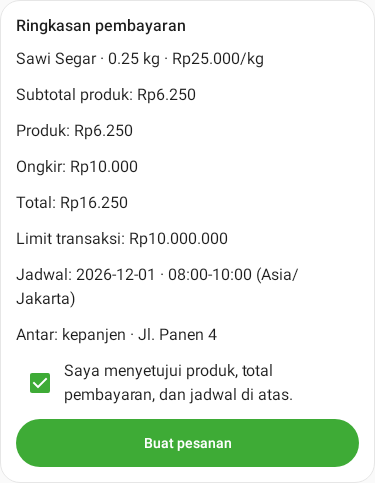
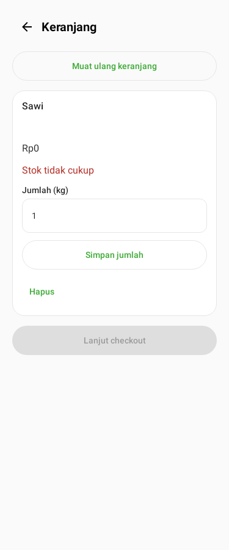

# Finalisasi Gibran — backend dan integrasi Android F1–F4

Basis: `integrasi-api` commit `1b519e1` (termasuk notifikasi terbaru Geisar).
Branch kerja: `feature/gibran-f1-f4-finalisasi`.
README backend, migrasi lama, dan implementasi storage foto lokal tidak diubah.

## Endpoint ulasan

- `POST /api/v1/buyer/orders/{id}/review`, autentikasi pembeli, body `{"rating":5,"comment":"Sayur segar"}`.
- Respons pertama `201`, envelope `data` berisi id, orderId, buyerId, farmerId, rating, comment, createdAt.
- Rating bilangan bulat 1–5; komentar opsional maksimal 500 karakter. Komentar kosong disimpan null.
- Hanya pemilik pesanan, akun aktif, status `selesai`. Pemilik lain/role salah `403`; pesanan tidak ada `404`; belum selesai atau ulasan kedua `409`; input tidak valid `400`.
- Baris pesanan dikunci dalam transaksi; constraint UNIQUE(order_id) tetap menjadi perlindungan database. Permintaan bersamaan hanya menghasilkan satu ulasan.
- `GET /api/v1/buyer/orders/{id}/review` mengembalikan ulasan milik pembeli atau data null jika belum ada. Dipakai Android untuk memulihkan status Ulasan terkirim setelah halaman dibuka ulang atau respons pengiriman hilang.
- Rating katalog tetap memakai agregasi ulasan valid dari tabel yang sudah ada, tanpa rating buatan atau migrasi tambahan.

## Integrasi Android

- F1: produk baru disimpan sebagai draft, lalu edit → pilih foto JPEG/PNG → upload → lihat foto tersimpan → aktifkan. Gambar memakai `photoAccessUrl` dari backend. Keterangan KTP, lokasi, pembayaran, foto, dan stok membantu menjelaskan syarat publikasi; keputusan akhir dan alasan penolakan berasal dari backend.
- F2: katalog, tambah, ubah jumlah desimal, hapus, keranjang kosong/loading, alasan stok tidak tersedia dan error server. Perubahan keranjang membatalkan quote lama.
- F3: kecamatan dan layanan antar berasal dari detail produk backend; tanggal/slot berasal dari fulfillment-options. Android tidak membuat tanggal, slot, ongkir, atau perhitungan ketersediaan sendiri.
- F4: ringkasan menampilkan harga/item, subtotal, ongkir, total, limit, jadwal, dan alamat/lokasi dari preview backend. Checkbox persetujuan wajib dan direset ketika quote berubah. Token quote dan fulfillment dikirim pada checkout.
- Penolakan checkout `400/409` membatalkan quote/jadwal dan meminta pengguna memuat ulang keranjang serta menyetujui ulang. Kegagalan sementara mempertahankan payload dan Idempotency-Key untuk retry aman.
- Ulasan tampil pada detail pesanan selesai. Form mewajibkan bintang, membatasi komentar, lalu menampilkan Ulasan terkirim. Jika pengiriman ulang mendapat `409`, aplikasi membaca ulasan yang sudah tersimpan.

## Cakupan pengujian

Backend: CheckoutIntegrationTest (ulasan berhasil/otorisasi/status/input/duplikasi/concurrency), LocalProductPhotoIntegrationTest (fixture sawi, syarat publikasi, foto lokal sampai checkout idempoten), serta suite regresi CartIntegrationTest, SchedulingIntegrationTest, CheckoutPreviewIntegrationTest, dan test backend lainnya.

Android: CommerceFlowTest menguji request API keranjang desimal, area/jadwal server, token checkout, perubahan quote, retry idempotensi, pemulihan ulasan, serta upload foto dari content URI dengan fixture sawi. ConnectedAppTest memeriksa state keranjang dan persetujuan checkout yang harus diulang saat quote berubah.

Hasil verifikasi 23 November 2026:

- Backend: **262 test lulus, 0 gagal, 0 error**, `bootJar` berhasil. Test integrasi memakai PostgreSQL sementara. Test adapter MinIO `ProductPhotoIntegrationTest` (11 skenario) sengaja tidak dijalankan; storage lokal beserta fixture sawi diuji melalui `LocalProductPhotoIntegrationTest`. Tidak ada MinIO yang dinyalakan untuk pekerjaan ini.
- Android: **92 test lulus, 0 gagal, 0 error**, `assembleDebug` berhasil. APK debug tersedia sebagai artefak handoff, bukan file sumber dalam Git.
- Lingkungan: Linux, JDK 17, Gradle 8.14.3 yang tersedia di lingkungan pengerjaan, Android SDK 35. Versi wrapper proyek tidak diubah. Cache/home Robolectric dialihkan melalui init script lokal karena direktori home lingkungan hanya bisa dibaca; tidak ada perubahan konfigurasi proyek untuk mengatasi batasan lingkungan tersebut.
- Masih ada warning deprecation Gradle/ikon dan log renderer/font pada test lama. Tidak ada kegagalan build/test yang tersisa.

Screenshot berikut berasal dari Robolectric/Compose dengan fixture UI, **bukan HP fisik atau bukti sesi backend langsung**:





Untuk menjalankan ulang di laptop:

```bash
cd backend
./gradlew test bootJar --tests '*Checkout*' --tests '*CartIntegrationTest' --tests '*Local*' --tests '*Scheduling*' --tests '*OrderStatusRulesTest' --tests '*PaymentStatusRulesTest' --tests '*ProductPhotoStorageTest' --tests '*SchedulerWiringTest' --tests '*UploadExceptionHandlerTest'
cd ../android-app
./gradlew :app:testDebugUnitTest :app:assembleDebug
```

Perintah backend di atas memilih suite yang diuji tanpa adapter MinIO. Screenshot otomatis dapat dibuat dengan menambahkan `-Proborazzi.test.record=true` pada perintah Android.

## UAT di HP yang masih harus dilakukan Gibran

1. Jalankan backend dengan storage foto lokal sesuai konfigurasi README; jangan jalankan MinIO. Gunakan database demo yang sudah disiapkan tim dan akun demo dari README.
2. Untuk HP USB, aktifkan USB debugging dan jalankan `adb reverse tcp:8080 tcp:8080`. Build dengan `-PPANENKU_API_URL=http://127.0.0.1:8080/api/v1/`. Emulator menggunakan default `10.0.2.2`.
3. Sebagai Asep: buat draft, upload `backend/demo-assets/foto-dummy/produk-sawi-segar.png`, periksa foto, edit harga/stok/tanggal, lalu aktifkan. Pastikan profil/KTP dan metode pembayaran sudah memenuhi aturan backend.
4. Sebagai Mok: katalog → tambah 0,25 kg → ubah jumlah → hapus → tambah lagi → pilih pickup/delivery → kecamatan/tanggal/slot → preview → setujui → checkout. Catat id pesanan.
5. Ulangi dengan stok kurang, produk nonaktif, serta jadwal yang lewat. Setelah preview, ubah harga/ongkir/jadwal dari akun petani, lalu konfirmasi checkout lama; harus ditolak dan meminta pemeriksaan ulang.
6. Coba kehilangan koneksi ketika checkout lalu retry. Pastikan hanya satu pesanan terbentuk. Jangan membuat pesanan baru dengan tombol/alur lain sebelum memeriksa hasil retry.
7. Selesaikan alur pembayaran/pemenuhan/penerimaan bersama Rampan, lalu kirim ulasan. Buka ulang detail; harus tetap Ulasan terkirim. Pesanan belum selesai tidak boleh menampilkan form aktif.
8. Simpan screenshot produk/foto, keranjang, pilihan jadwal, preview/persetujuan, hasil checkout, dan ulasan. Catat model HP, versi Android, base URL, waktu, serta error jika ada.

HP fisik tidak tersedia di lingkungan pengerjaan ini. UAT perangkat, koneksi HP ke backend, dan screenshot HP belum dapat diklaim selesai.
